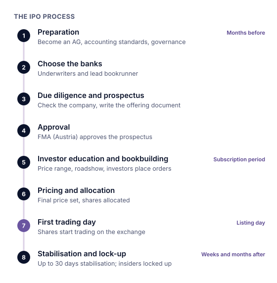

### What happens

1. **Preparation:** accounts, governance and, in Austria, conversion into an AG.
2. **Choosing banks:** the **underwriters**, led by a **bookrunner**.
3. **Due diligence and prospectus:** the official offering document.
4. **Approval:** by the national regulator in the EU (in the US, registration with the SEC).
5. **Price range** from talks with investors, then the **roadshow** and **bookbuilding**: investors say how many shares they want and up to what price.
6. **Pricing and allocation:** the company sets the final price; if the offer is **oversubscribed**, investors get only part of what they ordered.
7. **Greenshoe and stabilisation:** extra shares and price support in the first weeks.
8. **Listing day:** the first trade, often after an opening auction. The price may "pop" above the offer price or "break" below it.
9. **Lock-up:** insiders agree not to sell for a period after the IPO.

An IPO can sell **primary shares** (new shares; the money goes to the company) and **secondary shares** (existing shares; the money goes to the sellers).

### Who is involved

The company, its owners, underwriting banks, lawyers, auditors, the regulator (in Austria the **FMA**), institutional and private investors, and the stock exchange.

### Example with numbers

> [!EXAMPLE]
> A company with **50 million shares** sells **15 million** at **€20**.
>
> - Money raised: 15m × €20 = **€300 million**
> - Market capitalisation: 50m × €20 = **€1 billion**
> - Free float: 15m ÷ 50m = **30%**
>
> Under EU rules, the greenshoe may be at most **15%** of the original offer: here up to 2.25 million extra shares.

> [!AUSTRIA]
> The **FMA** approves the prospectus after checking it for completeness, coherence and comprehensibility, not for correctness. The prime market requires a free float of at least **25%**, worth at least **€20 million**.

> [!NOTE] In the United States
> Companies register the offering with the SEC, typically on **Form S-1**. According to the SEC's investor site, most lock-ups last **180 days**, though terms vary.

Try it: in the bookbuilding simulator below, set the offer price for a fictional IPO and see how demand, coverage and the money raised change.
