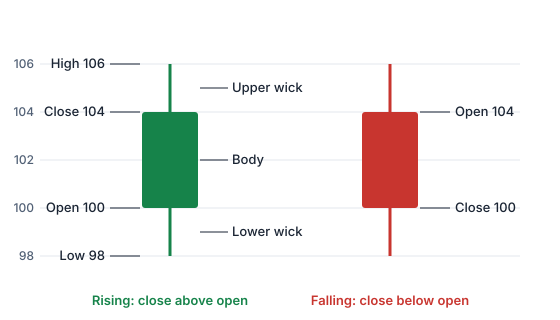

Eine Kerze (Candlestick) packt vier Kurse einer Periode in eine einzige Form: den **Eröffnungskurs**, das **Hoch**, das **Tief** und den **Schlusskurs** (zusammen: **OHLC**, von Open, High, Low, Close).

> [!ANIMATION] candle-forming
> Ein Beispiel-Handelstag wird zu einer Kerze: Der Kurs eröffnet bei 100, fällt auf 98, steigt auf 106 und schließt bei 104.

## Die Teile einer Kerze

- **Körper:** der dicke Teil zwischen Eröffnung und Schluss.
- **Dochte** (auch **Schatten** oder Lunten): die dünnen Linien über und unter dem Körper. Die Spitze des oberen Dochts ist das **Hoch**, das untere Ende des unteren Dochts das **Tief**.
- **Farbe:** Liegt der Schluss über der Eröffnung, ist der Kurs in der Periode gestiegen (oft grün oder weiß gezeichnet). Liegt der Schluss unter der Eröffnung, ist er gefallen (oft rot oder schwarz).

> [!EXAMPLE]
> Die Kurse eines Tages: Eröffnung **100**, Hoch **106**, Tief **98**, Schluss **104**.
>
> - Der Körper reicht von 100 bis 104; es ist eine steigende (grüne) Kerze, weil der Schluss über der Eröffnung liegt.
> - Der obere Docht reicht von 104 bis zum Hoch bei 106; der untere von 100 hinunter zum Tief bei 98.
> - Gesamte Spanne: 106 − 98 = **8**. Der Körper ist 4, die Hälfte der Spanne.

> [!WARNING] Farben sind eine Einstellung, kein Gesetz
> Plattformen lassen dich die Farben wählen, und die Gewohnheiten sind verschieden: Am chinesischen Aktienmarkt steht Rot für einen **steigenden** Kurs und Grün für einen fallenden, das Gegenteil der meisten westlichen Plattformen. Prüfe immer die Einstellung der Plattform oder schau, ob der Schluss über oder unter der Eröffnung liegt.

## Was eine Kerze dir sagt

Technische Analysten lesen eine Kerze als kurze Geschichte über Käufer und Verkäufer in dieser Periode:

- **Langer Körper:** Der Kurs hat sich von der Eröffnung bis zum Schluss stark bewegt: Eine Seite hatte klar die Kontrolle.
- **Kleiner Körper:** Eröffnung und Schluss lagen nah beieinander: Keine Seite hat gewonnen, ein Zeichen von **Unentschlossenheit**.
- **Langer oberer Docht:** Der Kurs ist in der Periode gestiegen, wurde aber vor dem Schluss wieder gedrückt: Höhere Kurse wurden **abgelehnt**.
- **Langer unterer Docht:** Der Kurs ist in der Periode gefallen, aber Käufer haben ihn wieder hochgeschoben: Tiefere Kurse wurden abgelehnt.
- **Keine Dochte:** Die Periode hat an einem Extrem eröffnet und am anderen geschlossen: starker einseitiger Druck.

## Der Zusammenhang zählt mehr als die Form

Dieselbe Kerze kann je nachdem, wo sie auftaucht, Verschiedenes bedeuten:

- Nach einem langen Anstieg oder einem langen Rückgang?
- Nahe einer Marke, an der der Kurs schon einmal gedreht hat (Unterstützung oder Widerstand, Lektion 6)?
- Ist sie groß oder klein **im Vergleich zu den letzten Kerzen**?
- War das **Volumen** höher oder niedriger als üblich?
- Welche **Zeiteinheit**? Ein Muster im 1-Minuten-Chart hat viel weniger Gewicht als dasselbe Muster im Wochenchart.

> [!MISTAKE] „Eine grüne Kerze heißt, der Kurs ist heute gestiegen“
> Sie heißt, dass der Schluss über der **Eröffnung** dieser Periode lag. Hat der Kurs mit einer großen Kurslücke nach unten eröffnet und sich dann etwas erholt, ist die Kerze grün, obwohl der Kurs unter dem gestrigen Schluss liegt.

## Ein bisschen Geschichte

Kerzencharts werden meist auf den japanischen Reishandel im 18. Jahrhundert zurückgeführt. Japans Börsenbetreiber beschreibt die 1730 genehmigte Dojima-Reisbörse in Osaka als die erste institutionelle Terminbörse der Welt. Populäre Darstellungen verbinden die Methode oft mit dem Reishändler Munehisa Homma, aber wie viel der heutigen Technik auf ihn zurückgeht, ist unsicher. Im Westen wurden Kerzen durch Steve Nisons Buch *Japanese Candlestick Charting Techniques* von 1991 bekannt.

Probier es aus: Klick im [Chart-Labor](/charts/lab) auf eine Kerze, um ihre Eröffnung, ihr Hoch, ihr Tief und ihren Schluss zu sehen.

## Das Wichtigste in Kürze

> [!TAKEAWAYS]
> - Eine Kerze zeigt vier Kurse: Eröffnung, Hoch, Tief und Schluss.
> - Der Körper reicht von der Eröffnung bis zum Schluss; die Dochte reichen bis zum Hoch und Tief.
> - Steigende und fallende Kerzen sind unterschiedlich gefärbt, aber Farben sind eine Einstellung und je nach Land verschieden.
> - Lange Körper deuten auf Überzeugung, kleine auf Unentschlossenheit, lange Dochte auf Ablehnung.
> - Lies eine Kerze immer im Zusammenhang: Trend, Marken, Größe, Volumen und Zeiteinheit.
