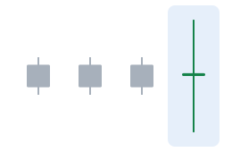
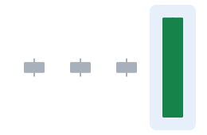

Kerzenformen haben bunte Namen, und zu jeder gibt es eine **traditionelle Deutung**: was Trader seit Langem glauben, dass sie signalisiert. Diese Lektion zeigt, wie jede Form aussieht, was Trader hineinlesen und wie sie häufig scheitert.

> [!WARNING] Muster sind Wahrscheinlichkeiten, keine Versprechen
> Keine Kerze zwingt den Kurs zu irgendetwas. Wo vorhanden, zeigen wir, wie sich ein Muster in den großen Tests von Thomas Bulkowski an US-Aktien tatsächlich verhalten hat. Diese Zahlen messen nur die **Richtung** der nächsten Bewegung, nicht, ob der Handel mit dem Muster nach Kosten Geld gebracht hat. Lektion 5 schaut sich die Belege genauer an.

In den Zeichnungen zeigen graue Kerzen den Zusammenhang (die Bewegung vor dem Muster), und die farbigen Kerzen sind das Muster selbst.

## Kerzen der Unentschlossenheit

### Doji

- **Aussehen:** Eröffnung und Schluss (fast) beim selben Kurs; der Körper ist nur ein dünner Strich.
- **Traditionelle Deutung:** Unentschlossenheit. Nach einer langen Bewegung sehen manche Trader darin eine Warnung, dass die Bewegung ermüdet.
- **Wie sie scheitert:** Dojis sind sehr häufig und bedeuten oft nichts, vor allem in kurzen Zeiteinheiten.

**Varianten:** Der **Long-legged Doji** hat auf beiden Seiten lange Dochte; der **Dragonfly Doji** (Libelle) hat einen langen unteren Docht und schließt am Hoch; der **Gravestone Doji** (Grabstein) hat einen langen oberen Docht und schließt am Tief. In Bulkowskis Tests hat der Gravestone Doji einen Anstieg nur etwa in der Hälfte der Fälle (51 %) umgekehrt.

### Spinning Top

- **Aussehen:** ein kleiner Körper in der Mitte, mit Dochten auf beiden Seiten, die länger als der Körper sind.
- **Traditionelle Deutung:** Unentschlossenheit, ähnlich wie ein Doji.
- **Wie er scheitert:** Er ist eine der häufigsten Kerzen überhaupt; allein trägt er wenig Information (Bulkowski fand nur in 50 % der Fälle eine Umkehr).

## Starke einseitige Kerzen

### Marubozu

- **Aussehen:** ein langer Körper ohne (oder mit winzigen) Dochten. Ein steigender Marubozu eröffnet am Tief und schließt am Hoch.
- **Traditionelle Deutung:** Eine Seite hatte vom ersten bis zum letzten Geschäft die Kontrolle; traditionell als Schwung in Richtung des Körpers gelesen.
- **Wie er scheitert:** Eine große Kerze kann auch der letzte Ausbruch einer Bewegung sein. Bulkowski maß in 56 % der Fälle eine Fortsetzung.

## Gleiche Form, anderer Zusammenhang

### Hammer und Hanging Man

- **Aussehen:** ein kleiner Körper oben, ein langer unterer Docht (traditionell mindestens doppelt so lang wie der Körper) und kein oder kaum ein oberer Docht.
- Nach einem **Rückgang** heißt er **Hammer**: Verkäufer haben den Kurs gedrückt, aber Käufer haben ihn zurückgeholt. Traditionell als mögliche Aufwärtswende gelesen. Bulkowski: Aufwärtswende in 60 % der Fälle.
- Nach einem **Anstieg** ist dieselbe Form ein **Hanging Man** (hängender Mann): traditionell als Warnung vor einer Abwärtswende gelesen. Aber in Bulkowskis Tests ist der Kurs häufiger **weiter gestiegen** (Fortsetzung nach oben in 59 % der Fälle).

### Inverted Hammer und Shooting Star

- **Aussehen:** ein kleiner Körper unten, ein langer oberer Docht und kein oder kaum ein unterer Docht.
- Nach einem **Anstieg** ist es ein **Shooting Star** (Sternschnuppe): Käufer haben höher getrieben, aber Verkäufer haben übernommen. Traditionell eine mögliche Abwärtswende; Bulkowski: Abwärtswende in 59 % der Fälle.
- Nach einem **Rückgang** ist es ein **Inverted Hammer** (umgekehrter Hammer): traditionell eine mögliche Aufwärtswende, aber in Bulkowskis Tests ging der Rückgang in 65 % der Fälle **weiter**.

> [!MISTAKE] „Ich habe einen Hammer gefunden, also wird der Kurs steigen“
> Ein Hammer sagt dir, dass tiefere Kurse **während einer Periode** abgelehnt wurden. Trader, die ihn nutzen, warten meist auf eine **Bestätigung**, etwa dass die nächste Kerze höher schließt, und legen vorher fest, wo sie zugeben würden, dass die Idee falsch war (zum Beispiel unter dem Tief des Hammers).

Jede Form hat ihre eigene Karte in der [Kerzen-Lexikon](/charts/candles), und im [Chart-Labor](/charts/lab) kannst du auf jede Kerze klicken, um zu sehen, welche Form sie ist und warum.

## Das Wichtigste in Kürze

> [!TAKEAWAYS]
> - Dojis und Spinning Tops zeigen Unentschlossenheit; ein Marubozu zeigt einseitigen Druck.
> - Hammer und Hanging Man sind dieselbe Form; nur der Trend davor ändert Namen und Deutung.
> - Dasselbe gilt für Inverted Hammer und Shooting Star.
> - Traditionelle Deutungen scheitern oft: Manche Muster haben sich in großen Tests umgekehrt verhalten.
> - Warte auf eine Bestätigung und wisse, wo deine Idee widerlegt wäre.
