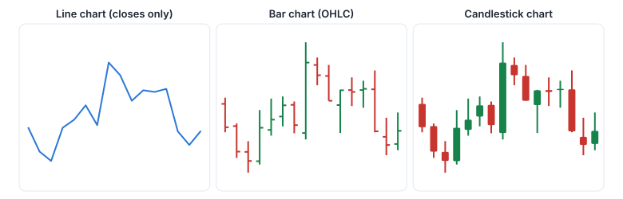
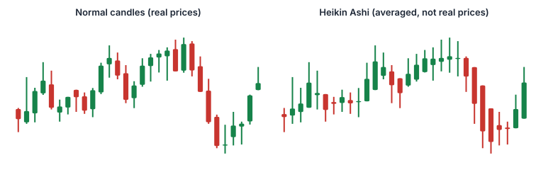
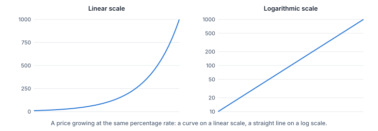

Ein Chart ist einfach ein Bild davon, wie sich ein Kurs entwickelt hat. Die senkrechte Achse zeigt den **Kurs**, die waagrechte Achse die **Zeit**. Alles andere auf einem Chart, von Kerzen bis zu Indikatoren, baut auf diesen zwei Achsen auf.

> [!NOTE]
> Die Chart-Schule bringt dir bei, Charts zu **lesen**. Sie gibt keine Kauf- oder Verkaufssignale, und kein Chart kann dir sagen, was ein Kurs als Nächstes tut. Alle Beispielcharts auf dieser Website verwenden **simulierte** Kurse.

## Charttypen

- **Linienchart:** verbindet die Schlusskurse. Übersichtlich und gut für das große Bild, verbirgt aber, was in jeder Periode passiert ist.
- **Balkenchart (OHLC):** Jede Periode ist eine senkrechte Linie vom **Hoch** zum **Tief**, mit einem kurzen waagrechten Strich links für den **Eröffnungskurs** und rechts für den **Schlusskurs**.
- **Kerzenchart (Candlestick):** zeigt dieselben vier Kurse wie ein Balkenchart, aber der Bereich zwischen Eröffnung und Schluss wird als dicker **Körper** gezeichnet, gefärbt danach, ob der Kurs gestiegen oder gefallen ist. Die nächste Lektion erklärt Kerzen im Detail.
- **Flächenchart:** ein Linienchart mit gefüllter Fläche darunter.
- **Heikin Ashi:** geglättete Kerzen aus **Durchschnitten** der aktuellen und der vorigen Periode. Sie lassen Trends sauberer aussehen, aber ihre Eröffnungs- und Schlusswerte sind **keine tatsächlich gehandelten Kurse**.
- **Renko und Kagi:** Charts, die die Zeit ignorieren und nur dann einen neuen Baustein oder eine neue Linie zeichnen, wenn sich der Kurs um einen festen Betrag bewegt. Als Einsteiger brauchst du sie selten.

## Zeiteinheiten

Jede Kerze oder jeder Balken steht für eine **Periode**: 1 Minute, 5 Minuten, 1 Stunde, 1 Tag, 1 Woche oder 1 Monat. Ein Tageschart hat eine Kerze pro Handelstag; ein Wochenchart fasst fünf Tage zu einer Kerze zusammen.

Derselbe Markt kann in verschiedenen Zeiteinheiten völlig anders aussehen: Ein scharfer Einbruch im 5-Minuten-Chart ist im Wochenchart vielleicht nur eine winzige Delle. Längere Zeiteinheiten geben den größeren Zusammenhang; kürzere zeigen Details und Rauschen.

> [!EXAMPLE]
> Eine Aktie wird 390 Minuten am Tag gehandelt (zum Beispiel 9:30–16:00). Im 1-Stunden-Chart wird dieser Tag zu sechs vollen Stundenkerzen plus einer siebten, kürzeren Kerze für die letzten 30 Minuten. Im Tageschart ist er eine Kerze.

## Lineare oder logarithmische Skala

Auf einer **linearen** Skala ist jeder Schritt auf der Kursachse gleich viele Euro: 10 → 20 nimmt gleich viel Platz ein wie 100 → 110. Auf einer **logarithmischen** Skala ist jeder Schritt gleich viele **Prozent**: 10 → 20 (+100 %) nimmt gleich viel Platz ein wie 100 → 200 (+100 %).

Bei langen Zeiträumen und Kursen, die stark gewachsen sind, ist die logarithmische Skala meist ehrlicher: Sie zeigt prozentuale Bewegungen in ihrer wahren relativen Größe.

## Volumen

Die meisten Charts zeigen das **Volumen** (die Zahl der in jeder Periode gehandelten Aktien) als Balken unter dem Kurs. Eine große Kursbewegung bei hohem Volumen hatte viele Beteiligte; dieselbe Bewegung bei sehr niedrigem Volumen wenige. Das Volumen kommt in den Lektionen über Trends und Indikatoren wieder vor.

## Was einen Chart irreführend machen kann

- **Bereinigte und unbereinigte Kurse:** Nach einem Aktiensplit fällt der Aktienkurs (zum Beispiel von 100 € auf 50 € nach einem 2:1-Split), ohne dass jemand Geld verliert. Chart-Plattformen **bereinigen** ältere Kurse meist, damit der Chart keinen falschen Absturz zeigt. Manche Plattformen bieten auch eine Bereinigung um Dividenden an. Prüfe die Einstellung, bevor du alte und neue Kurse vergleichst.
- **Zeitzonen und Sitzungen:** Eine Tageskerze umfasst den Handelstag der Börse in ihrer eigenen Zeitzone. Manche Plattformen zeigen auch Kerzen aus dem **vor- und nachbörslichen** Handel (siehe Kategorie E).
- **Kurslücken:** Eröffnet die nächste Periode weit weg vom vorigen Schlusskurs, etwa nach Nachrichten über Nacht, zeigt der Chart einen leeren Raum: eine **Kurslücke** (Gap).
- **Verzögerte Daten:** Viele Börsen verlangen Geld für Echtzeitkurse, also sind kostenlose Charts oft **verzögert**, um eine Zeitspanne, die von der Börse abhängt. Prüfe, ob dein Chart live ist, bevor du dich auf die letzte Kerze verlässt.

> [!MISTAKE] „Der Chart zeigt einen Absturz, also hat das Unternehmen die Hälfte seines Werts verloren“
> Prüfe zuerst, ob es einen Aktiensplit gab. Ist der Chart unbereinigt, sieht ein 2:1-Split wie ein Einbruch um 50 % aus, obwohl die Aktionäre einfach doppelt so viele Aktien zum halben Preis besitzen.

## Das Wichtigste in Kürze

> [!TAKEAWAYS]
> - Ein Chart trägt den Kurs gegen die Zeit auf; Linien-, Balken- und Kerzencharts sind die häufigsten Typen.
> - Heikin-Ashi-Kerzen sind Durchschnitte und zeigen keine echten gehandelten Kurse.
> - Jede Kerze steht für eine Periode; die Zeiteinheit verändert, was du siehst.
> - Eine logarithmische Skala zeigt prozentuale Bewegungen in ihrer wahren Größe, nützlich für lange Zeiträume.
> - Prüfe bereinigte Kurse, Zeitzone, Sitzungen und ob die Daten verzögert sind.
