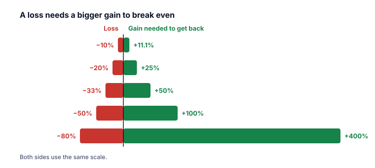

Aktienmärkte steigen nicht in einer geraden Linie. Sie bewegen sich in langen Wellen von Optimismus und Pessimismus. Anleger verwenden für diese Wellen zwei Tiernamen.

## Bulle und Bär

Investor.gov (die Anlegerinformationsseite der SEC) definiert sie so:

- Ein **Bullenmarkt** ist eine Zeit, in der die Kurse steigen und die Stimmung optimistisch ist. Allgemein ist es, wenn ein breiter Marktindex über mindestens zwei Monate um **20 % oder mehr** steigt.
- Ein **Bärenmarkt** ist eine Zeit, in der die Kurse fallen und die Stimmung pessimistisch ist. Allgemein ist es, wenn ein breiter Marktindex über mindestens zwei Monate um **20 % oder mehr** fällt.

Ein kleinerer Rückgang, oft um die 10 %, wird üblicherweise **Korrektur** genannt. Eine offizielle Definition der Korrektur gibt es nicht; es ist Börsenjargon.

> [!NOTE] Schwellen sind Konventionen
> Bei genau −20 % passiert nichts Magisches. Die Bezeichnungen sind eine praktische Abkürzung für Medien und Anleger. Für dich zählt, wie groß der Rückgang ist, wie lange er dauert und wie lange die Erholung braucht.

## Drawdown: den Rückgang messen

Ein **Drawdown** ist der Rückgang vom höchsten Punkt (dem Hoch) bis zu einem späteren Tief, in Prozent.

> [!EXAMPLE] Ein Drawdown
> Ein Index erreicht ein Hoch bei 4.000 Punkten und fällt später auf 2.600.
> Drawdown = (2.600 − 4.000) ÷ 4.000 = **−35 %**.

## Verluste und Gewinne sind nicht symmetrisch

Das ist eine der wichtigsten Tatsachen beim Investieren. Nach einem Verlust brauchst du einen **größeren** prozentualen Gewinn, nur um wieder dort zu sein, wo du angefangen hast, weil der Gewinn auf einen kleineren Betrag berechnet wird.

| Verlust | Nötiger Gewinn, um aufzuholen |
|---:|---:|
| −10 % | +11,1 % |
| −20 % | +25 % |
| −33 % | +50 % |
| −50 % | +100 % |
| −80 % | +400 % |
| −90 % | +900 % |

Formel: nötiger Gewinn = 1 ÷ (1 − Verlust) − 1.

> [!EXAMPLE] Die Hälfte verlieren
> 10.000 € fallen um 50 % auf 5.000 €. Ein Gewinn von 50 % bringt sie nur auf 7.500 €. Um wieder auf 10.000 € zu kommen, müssen sie sich **verdoppeln** (+100 %).

Deshalb schaden große Verluste so sehr, und deshalb konzentriert sich das Risikomanagement (Kategorie P) darauf, sie zu vermeiden.

## Wie oft fallen Märkte?

Aswath Damodaran an der NYU Stern veröffentlicht die jährliche Gesamtrendite des US-Index S&P 500 (einschließlich Dividenden) seit 1928. Nach seinen Daten für **1928 bis 2025** (98 Jahre):

- Der Index hat das Jahr **in 26 der 98 Jahre tiefer** beendet, etwa in einem von vier Jahren.
- Die schlechtesten Kalenderjahre waren **1931 (−43,8 %)**, **2008 (−36,6 %)** und **1937 (−35,3 %)**.
- Zu den besten gehörten **1954 (+52,6 %)** und **1933 (+50,0 %)**.
- Über längere Haltedauern waren Verluste seltener: Jeder **20-Jahres-Zeitraum** in diesen Daten hatte eine positive Gesamtrendite, manche 10-Jahres-Zeiträume waren aber negativ.

> [!WARNING] Die Vergangenheit ist keine Garantie
> Diese Zahlen beschreiben ein Land, die USA, deren Markt sich im 20. Jahrhundert ungewöhnlich gut entwickelt hat. Andere Märkte hatten viel längere schlechte Zeiten (Lektion 4 schaut auf Japan). Die Zahlen sind außerdem vor Kosten, Steuern und Inflation und in US-Dollar.

## Warum Märkte fallen

Bärenmärkte haben ganz unterschiedliche Ursachen: eine platzende Blase (2000), eine Bankenkrise (2008), eine Pandemie (2020), hohe Inflation und steigende Zinsen oder Krieg. Manche kommen mit einer tiefen Rezession, manche nicht. Die Lektionen in dieser Kategorie gehen die wichtigsten Episoden durch.

> [!MISTAKE] „Ich verkaufe vor dem Bärenmarkt und kaufe am Tief zurück“
> Hochs und Tiefs sind erst im Nachhinein klar, und Erholungen können plötzlich kommen. Nach dem Crash vom 19. Oktober 1987 holte der Dow Jones innerhalb von zwei Handelstagen 57 % des Tagesverlusts wieder auf (Federal Reserve History). Wer in Panik verkauft, kann solche Bewegungen verpassen. Kategorie O behandelt die Psychologie.

## Das Wichtigste in Kürze

> [!TAKEAWAYS]
> - Bullenmarkt: ein Anstieg um 20 % oder mehr; Bärenmarkt: ein Rückgang um 20 % oder mehr (die allgemeinen Definitionen von Investor.gov).
> - Ein Drawdown misst den Rückgang von einem Hoch bis zu einem späteren Tief.
> - Verluste brauchen größere Gewinne, um aufgeholt zu werden: −50 % braucht +100 %.
> - In den US-Daten für 1928–2025 endete etwa eines von vier Jahren mit einem Verlust.
> - Die lange Geschichte eines einzigen Markts ist ein Anhaltspunkt, kein Versprechen.
