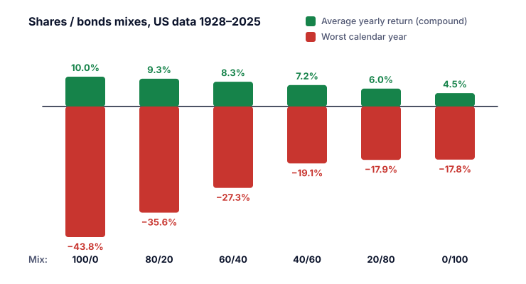

**Asset-Allokation** (Vermögensaufteilung) heißt, ein Portfolio auf verschiedene Anlageklassen wie Aktien, Anleihen und Bargeld aufzuteilen (SEC). Die SEC nennt die Wahl der Mischung „eine sehr persönliche“, die vor allem von deinem **Anlagehorizont** und deiner **Risikotoleranz** abhängt (Lektionen 1 und 2).

## Die drei wichtigsten Anlageklassen

Der Einsteigerleitfaden der SEC beschreibt sie so:

| Klasse | Charakter |
|---|---|
| **Aktien** | Historisch das größte Risiko und die höchsten Renditen. Kurzfristig sehr riskant; Anleger, die die Schwankungen über lange Zeiträume ausgesessen haben, wurden meist belohnt. |
| **Anleihen** | Meist weniger volatil als Aktien, mit bescheideneren Renditen. Hochzinsanleihen („Junk Bonds“) können höhere Renditen bieten, tragen aber höheres Risiko. |
| **Bargeld und Gleichwertiges** | Am sichersten, mit der niedrigsten Rendite. Die größte Gefahr ist die **Inflation**: Die Renditen halten vielleicht nicht mit steigenden Preisen Schritt. |

Es gibt auch andere Klassen wie Immobilien, Gold und andere Rohstoffe (Kategorie U).

## Warum die Mischung zählt

Die SEC erklärt, dass sich die Renditen der wichtigsten Anlageklassen historisch **nicht gleichzeitig auf und ab bewegt** haben. Läuft eine schlecht, läuft eine andere vielleicht besser, also ergibt ihre Kombination einen ruhigeren Verlauf. Gleichzeitig entscheidet die Mischung, ob du dein Ziel voraussichtlich erreichst: zu wenig Risiko, und die Rendite ist vielleicht zu niedrig; zu viel, und das Geld ist vielleicht nicht da, wenn du es brauchst.

## Wie sich verschiedene Mischungen verhalten haben: 1928–2025

Die Tabelle unten verwendet Damodarans jährliche US-Daten für den S&P 500 (mit Dividenden) und 10-jährige US-Staatsanleihen. Jede Mischung wird zu Beginn jedes Jahres auf ihr Ziel zurückgesetzt. Die Renditen sind in US-Dollar, vor Inflation, Kosten und Steuern.

| Aktien / Anleihen | Durchschnittliche Jahresrendite | Verlustjahre (von 98) | Schlechtestes Kalenderjahr | Größter Rückgang vom Jahresend-Hoch | 2008 | 2022 |
|---|---:|---:|---:|---:|---:|---:|
| 100 / 0 | 10,0 % | 26 | −43,8 % (1931) | −64,8 % | −36,5 % | −18,0 % |
| 80 / 20 | 9,3 % | 25 | −35,6 % (1931) | −53,5 % | −25,2 % | −18,0 % |
| 60 / 40 | 8,3 % | 21 | −27,3 % (1931) | −40,1 % | −13,9 % | −18,0 % |
| 40 / 60 | 7,2 % | 20 | −19,1 % (1931) | −25,6 % | −2,6 % | −17,9 % |
| 20 / 80 | 6,0 % | 15 | −17,9 % (2022) | −17,9 % | +8,8 % | −17,9 % |
| 0 / 100 | 4,5 % | 20 | −17,8 % (2022) | −21,5 % | +20,1 % | −17,8 % |

*Eigene Berechnung aus Damodarans Jahresrenditen. „Durchschnittliche Jahresrendite“ ist die durchschnittliche jährliche Wachstumsrate mit Zinseszins. „Größter Rückgang“ ist nur an Jahresendwerten gemessen; Rückgänge innerhalb eines Jahres waren tiefer.*

Was die Tabelle zeigt:

1. **Mehr Aktien, höhere langfristige Rendite, tiefere Rückgänge.** Von 60 % auf 100 % Aktien zu gehen, erhöhte die durchschnittliche Rendite um weniger als 2 Prozentpunkte pro Jahr, vertiefte aber den größten Rückgang von −40 % auf −65 %.
2. **Mischen half meistens.** 2008 stiegen die Anleihen, während die Aktien fielen, und federten ein gemischtes Portfolio ab.
3. **Aber nicht immer.** 2022 fielen Aktien und Anleihen gemeinsam, also verlor jede Mischung etwa 18 %.
4. **Reine Anleihen waren nicht risikolos.** Auch ein reines Anleiheportfolio hatte Verlustjahre und einen Rückgang von mehr als 20 %.

> [!WARNING] Ein Land, ein Zeitraum
> Das ist US-Geschichte in Dollar. Andere Länder, Zeiträume und Währungen ergeben andere Zahlen, und die Zukunft kann wieder anders sein. Nutze die Tabelle, um Abwägungen zu verstehen, nicht um Renditen vorherzusagen.

## Eine Mischung wählen

Die SEC merkt an, dass die richtige Aufteilung kompliziert zu bestimmen ist: Du versuchst, eine Mischung mit der **höchsten Wahrscheinlichkeit zu wählen, dein Ziel bei einem Risiko zu erreichen, mit dem du leben kannst**, und sie anzupassen, wenn das Ziel näher rückt. Einige gängige Ideen:

- **Getrennte Töpfe je Ziel.** Kurzfristige Ziele in Bargeld, langfristige mit mehr Aktien.
- **Das Risiko verringern, wenn das Ziel näher rückt.** Die SEC merkt an, dass die meisten, die für die Pension investieren, mit zunehmender Nähe zum Pensionsalter weniger Aktien und mehr Anleihen und Bargeld halten. Zielfonds tun das automatisch (Lektion 8).
- **Die Mischung nur aus guten Gründen ändern:** eine Änderung deines Anlagehorizonts, deiner Risikotoleranz, deiner finanziellen Lage oder deines Ziels, nicht weil eine Klasse zuletzt gut gelaufen ist (SEC).

> [!MISTAKE] Dem Gewinner des letzten Jahres hinterherlaufen
> Die SEC warnt, dass kluge Anleger ihre Aufteilung typischerweise nicht nach der jüngsten Wertentwicklung ändern, etwa indem sie mehr Aktien kaufen, wenn der Markt heiß läuft. Genau dann rebalancieren sie stattdessen (Lektion 5).

## Das Wichtigste in Kürze

> [!TAKEAWAYS]
> - Asset-Allokation ist die Aufteilung auf Aktien, Anleihen, Bargeld und andere Klassen; sie hängt von deinem Horizont und deiner Risikotoleranz ab.
> - In US-Daten für 1928–2025 hieß mehr Aktien höhere langfristige Renditen und viel tiefere Rückgänge.
> - Die Kombination von Anlageklassen glättete die Renditen meist, aber 2022 fielen Aktien und Anleihen gemeinsam.
> - Wähle eine Mischung, bei der du auch in einem schweren Rückgang bleibst.
> - Ändere die Mischung, wenn sich deine Lage ändert, nicht wegen der jüngsten Wertentwicklung.
