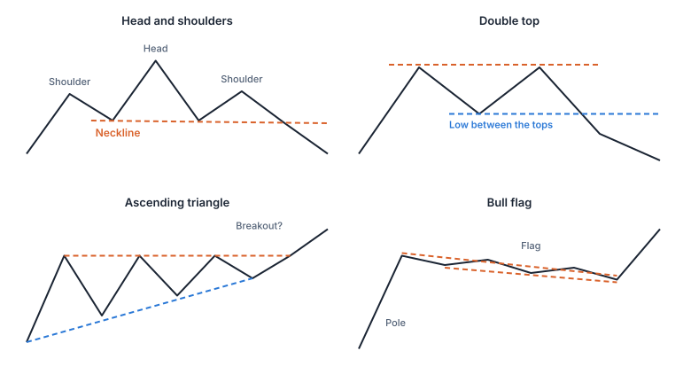

Los patrones de velas abarcan de una a tres velas. Las **figuras chartistas** son formas más grandes que se forman a lo largo de semanas o meses. Los analistas técnicos las dividen en figuras de **cambio de tendencia** (la tendencia puede darse la vuelta) y de **continuación** (la tendencia puede reanudarse tras una pausa).

## Figuras de cambio de tendencia

- **Hombro-cabeza-hombro:** tras una subida, un máximo (hombro izquierdo), un máximo más alto (cabeza) y un máximo más bajo (hombro derecho). La línea que pasa por los mínimos entre ellos es la **línea clavicular** (neckline). Tradicionalmente, los operadores toman la ruptura por debajo de la línea clavicular como la señal de giro. El hombro-cabeza-hombro **invertido** es la imagen especular tras una caída.
- **Doble techo / doble suelo:** dos máximos (o mínimos) a más o menos el mismo nivel. La idea es que el mercado fracasó dos veces en ir más allá. La señal que suelen esperar los operadores es la ruptura del mínimo (o máximo) **entre** los dos techos (o suelos).
- Los **triples techos y suelos** siguen la misma idea con tres intentos.

## Figuras de continuación

- **Triángulos:** el rango se estrecha a medida que los máximos y los mínimos convergen. Tradicionalmente, un triángulo **ascendente** (techo plano, mínimos crecientes) se lee como alcista, uno **descendente** (suelo plano, máximos decrecientes) como bajista, y uno **simétrico** puede romper hacia cualquier lado.
- **Rectángulos:** el precio se mueve en lateral entre un techo y un suelo planos (consolidación).
- **Banderas y banderines:** un movimiento brusco (el «mástil»), luego una breve pausa ligeramente inclinada en su contra (bandera) o que forma un pequeño triángulo (banderín), y después, a menudo, una continuación.

## Por qué son más difíciles de lo que parecen

- **Solo son seguras cuando están completas.** Un doble techo es solo «máximo, bajada, máximo» hasta que el precio rompe el mínimo entre los techos.
- **Subjetividad:** dos analistas pueden ver figuras distintas en el mismo gráfico. Lo, Mamaysky y Wang (2000) crearon un método informático precisamente porque las formas suelen estar «en los ojos de quien mira». Su estudio halló que algunas figuras aportaban información adicional en acciones de EE. UU., lo que no es lo mismo que una señal de trading fiable.
- **Figuras fallidas:** una figura que rompe y luego se da la vuelta (una figura «fallida») es algo frecuente.

> [!MISTAKE] «Veo que se está formando un hombro-cabeza-hombro, así que vendo ya»
> Hasta que se rompe la línea clavicular no hay hombro-cabeza-hombro, solo una serie de máximos. Muchas figuras aparentes nunca llegan a completarse.

Busca estas formas en los distintos escenarios del [Laboratorio de gráficos](/charts/lab).

## Ideas clave

> [!TAKEAWAYS]
> - Las figuras chartistas son formas más grandes: de cambio de tendencia (hombro-cabeza-hombro, dobles techos y suelos) y de continuación (triángulos, rectángulos, banderas).
> - La señal tradicional suele venir de la ruptura de una línea clave (la línea clavicular, el mínimo entre techos, un lado del triángulo).
> - Las figuras son subjetivas, solo están claras a posteriori y fallan a menudo.
