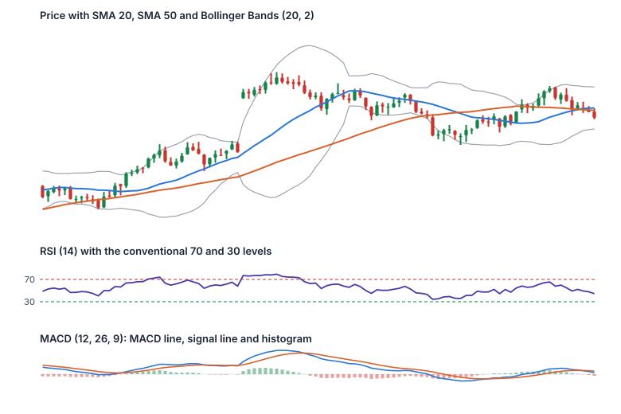

Un **indicador** es un cálculo basado en el precio (y a veces en el volumen) que se dibuja sobre el gráfico o debajo de él. Hay dos familias:

- Los **superpuestos** se dibujan encima del precio: medias móviles, bandas de Bollinger, VWAP.
- Los **osciladores** se dibujan en un panel aparte y se mueven dentro de un rango fijo o alrededor de cero: RSI, MACD.

> [!NOTE]
> Los indicadores se calculan **a partir del precio**. Pueden hacer más visibles los patrones, pero no añaden información nueva sobre el futuro, y la mayoría **van con retraso**: reaccionan después de que el precio se haya movido.

## Medias móviles (SMA y EMA)

- **Media móvil simple (SMA):** el precio de cierre medio de los últimos *n* periodos. Ejemplo: cierres de 45,50, 45,25 y 46,10 dan una SMA de 3 periodos de 136,85 ÷ 3 = **45,62**.
- **Media móvil exponencial (EMA):** da más peso a los precios recientes, así que reacciona más deprisa. Cada nuevo valor = precio × multiplicador + EMA anterior × (1 − multiplicador), con multiplicador = 2 ÷ (n + 1).
- **Longitudes habituales:** 20, 50, 100 y 200 periodos. Una media que sube sugiere una tendencia alcista; muchos operadores vigilan cuándo el precio cruza su media.
- **Cruce dorado / cruce de la muerte:** que la media de 50 días cruce **por encima** de la de 200 días se llama popularmente cruce dorado (golden cross), y que cruce **por debajo**, cruce de la muerte (death cross). Los dos se producen bastante después del giro del precio, por su propia construcción.

## RSI (índice de fuerza relativa)

- Compara el tamaño medio de los **movimientos al alza** con el de los **movimientos a la baja** durante un periodo (normalmente 14), en una escala de **0 a 100**.
- Niveles convencionales: por encima de **70**, «sobrecompra»; por debajo de **30**, «sobreventa».
- **La trampa:** en una tendencia fuerte, el RSI puede quedarse mucho tiempo por encima de 70 (o por debajo de 30) mientras el precio sigue avanzando. «Sobrecomprado» no significa «a punto de caer».
- **Divergencia:** el precio marca un nuevo máximo pero el RSI no. Los operadores lo leen como un impulso que se debilita; puede durar mucho tiempo.

## MACD (convergencia/divergencia de medias móviles)

- **Línea MACD:** la EMA de 12 periodos menos la EMA de 26 periodos.
- **Línea de señal:** una EMA de 9 periodos de la línea MACD.
- **Histograma:** línea MACD menos línea de señal.
- Los operadores vigilan los cruces entre la línea MACD y la de señal, y cuándo la línea MACD cruza el cero. Como se construye con medias móviles, el MACD también va con retraso.

## Bandas de Bollinger

Creadas por John Bollinger: una media móvil de 20 periodos con bandas **dos desviaciones típicas** por encima y por debajo (la configuración por defecto). Las bandas se ensanchan cuando los precios se vuelven más volátiles y se estrechan cuando se calman. Un estrechamiento marcado (**squeeze**) muestra una volatilidad inusualmente baja; los operadores esperan que la volatilidad vuelva a subir, pero las bandas no te dicen en qué dirección.

## VWAP (precio medio ponderado por volumen)

El precio medio del día, ponderado por lo que se negoció a cada precio: (suma de precio × volumen) ÷ (volumen total). Se **reinicia en cada sesión** y se usa sobre todo en el intradía. Muchos participantes del mercado usan estrategias de ejecución VWAP, que intentan comprar o vender una orden grande cerca del VWAP del día.

## ATR (rango verdadero medio)

Una medida de **volatilidad**, no de dirección: el tamaño medio del rango de cada periodo, incluido cualquier hueco respecto al cierre anterior. Una acción con un ATR de 2 € suele moverse unos 2 € al día. Los operadores lo usan, por ejemplo, para colocar los stops a una distancia razonable.

## Retrocesos de Fibonacci

Líneas trazadas en el **38,2 %, el 50 % y el 61,8 %** de un movimiento previo, donde algunos operadores esperan que un retroceso se detenga. Los porcentajes proceden de la serie de Fibonacci (el 50 % se añade por convención). Los niveles de Fibonacci son populares pero **subjetivos**: el resultado depende del máximo y el mínimo que elijas, y con varios niveles muy juntos, casi siempre parecerá que uno de ellos «funciona».

## Reglas prácticas

- **Más indicadores no es mejor.** Muchos indicadores muestran la misma información de formas distintas; cinco indicadores que coinciden no son cinco confirmaciones independientes.
- **Los valores por defecto son convenciones,** no leyes: 14 para el RSI o 20 para las bandas de Bollinger son costumbres, no valores óptimos.
- **Repintado:** algunos indicadores personalizados cambian sus valores pasados cuando llegan datos nuevos, así que parecen perfectos en el histórico pero dan señales distintas en tiempo real.

> [!MISTAKE] «El RSI está por encima de 70, así que debería vender»
> Un RSI por encima de 70 solo dice que las ganancias recientes superaron a las pérdidas recientes. En tendencias alcistas fuertes puede quedarse ahí semanas. La lectura de un indicador es una descripción, no una instrucción.

Activa y desactiva cada indicador, y cambia su configuración, en el [Laboratorio de gráficos](/charts/lab).

## Ideas clave

> [!TAKEAWAYS]
> - Los indicadores se calculan a partir del precio (y del volumen); no añaden información nueva y la mayoría van con retraso.
> - Las medias móviles suavizan el precio; las EMA reaccionan más deprisa que las SMA.
> - El RSI y otros osciladores pueden quedarse mucho tiempo en «sobrecompra» o «sobreventa» en tendencias fuertes.
> - El MACD se construye con medias móviles; las bandas de Bollinger y el ATR miden la volatilidad; el VWAP es una referencia intradía.
> - Los niveles de Fibonacci son subjetivos; pocos indicadores bien entendidos son mejores que una sobrecarga de indicadores.
