Los patrones de varias velas combinan dos o tres velas en una pequeña historia: un bando tenía el control y luego algo cambió. Como en la lección anterior, las velas grises muestran el contexto y las de color son el patrón. Las cifras de las pruebas proceden de los estudios de Thomas Bulkowski con acciones de EE. UU. y describen solo la **dirección** del movimiento siguiente, no los beneficios después de costes.

## Patrones envolventes

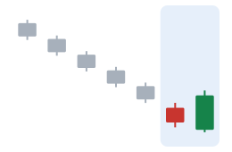

- **Envolvente alcista:** tras una caída, a una vela bajista le sigue una alcista cuyo cuerpo cubre por completo el primer cuerpo. Tradicionalmente, un posible giro alcista (en las pruebas: giro alcista el 63 % de las veces).
- **Envolvente bajista:** la imagen especular tras una subida (en las pruebas: giro bajista el 79 % de las veces).
- **Confirmación que esperan los operadores:** más movimiento en la nueva dirección. **Fallo:** el precio vuelve más allá del extremo del patrón.

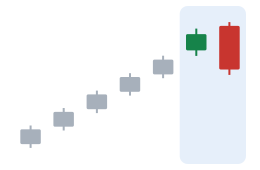

## Harami y cruz harami

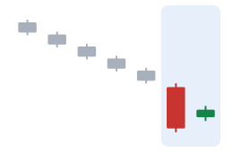

- **Harami** («embarazada» en japonés): una vela larga seguida de una pequeña de color contrario cuyo cuerpo queda dentro del primer cuerpo. Se lee como «el movimiento fuerte se ha detenido».
- **Cruz harami:** la segunda vela es un doji.
- **Cómo fallan:** la pausa suele ser solo un respiro. En las pruebas de Bulkowski, al harami bajista le siguió una **subida continuada** el 53 % de las veces, y a la cruz harami alcista una **caída continuada** el 55 % de las veces.

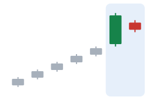

## Línea penetrante y cubierta de nube oscura

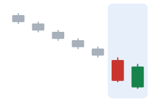

- **Línea penetrante:** tras una caída, una vela bajista larga y luego una alcista que abre por debajo del mínimo de la primera y cierra por encima de la mitad del primer cuerpo (en las pruebas: giro alcista el 64 % de las veces).
- **Cubierta de nube oscura:** la imagen especular tras una subida: la segunda vela abre por encima del máximo de la primera y cierra por debajo de la mitad de su cuerpo (en las pruebas: giro bajista el 60 % de las veces).

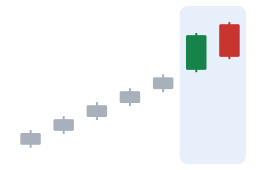

## Estrella de la mañana y estrella vespertina

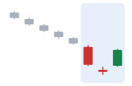

- **Estrella de la mañana:** tres velas tras una caída: una vela bajista larga, una pequeña «estrella» más abajo y luego una vela alcista larga que cierra bien dentro del primer cuerpo (en las pruebas: giro alcista el 78 % de las veces).
- **Estrella vespertina:** la imagen especular tras una subida (en las pruebas: giro bajista el 72 % de las veces).

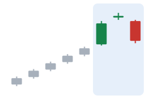

## Tres soldados blancos y tres cuervos negros

- **Tres soldados blancos:** tres velas alcistas largas seguidas, cada una abriendo dentro del cuerpo anterior y cerrando cerca de su máximo.
- **Tres cuervos negros:** tres velas bajistas largas seguidas.
- **Cuidado:** tras tres velas fuertes, el mercado ya se ha movido mucho. Quien actúa por el patrón compra o vende después del movimiento, no antes.

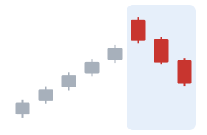

## Pinzas e inside bar

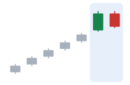

- **Techo / suelo en pinza:** dos velas con (casi) el mismo máximo o el mismo mínimo: el precio fracasó dos veces en el mismo nivel. En las pruebas de Bulkowski, los dos patrones de pinzas vieron con más frecuencia que la tendencia **continuaba** que un giro.
- **Inside bar:** una vela cuyo máximo y mínimo quedan dentro del rango de la vela anterior. El mercado se contrae; los operadores vigilan qué lado se rompe primero, y las rupturas falsas son frecuentes.

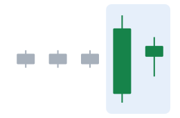

## Huecos

Un **hueco** (gap) es un espacio vacío entre una vela y la siguiente, cuando el precio abre muy lejos del cierre anterior (a menudo tras una noticia). Suelen distinguirse cuatro tipos:

- **Hueco común (de área):** un hueco corriente dentro de un rango, que a menudo se «cierra» (el precio vuelve a taparlo) poco después.
- **Hueco de escape:** el precio sale de un rango o de un patrón con un hueco, al inicio de un nuevo movimiento.
- **Hueco de continuación:** un hueco en mitad de un movimiento fuerte ya en marcha.
- **Hueco de agotamiento:** un último hueco cerca del final de un movimiento, tras el que el precio se da la vuelta.

El problema: qué tipo de hueco era suele verse claro solo **a posteriori**.

> [!MISTAKE] «El patrón está completo, así que el movimiento está garantizado»
> Incluso los patrones mejor probados fallan una gran parte de las veces, y las cifras anteriores no dicen nada del tamaño del movimiento ni del coste de operar. Los patrones describen lo que creen los operadores; no son una ley del mercado.

Todos los patrones, con su descripción completa, están en la [Enciclopedia de velas](/charts/candles).

## Ideas clave

> [!TAKEAWAYS]
> - Envolventes, harami, línea penetrante y nube oscura, estrellas y soldados/cuervos son los patrones clásicos de varias velas.
> - Cada uno tiene una lectura tradicional, una confirmación que esperan los operadores y una forma típica de fallar.
> - Algunos patrones se comportaron al revés en grandes pruebas; las cifras de las pruebas miden la dirección, no el beneficio.
> - Los huecos se llaman comunes, de escape, de continuación o de agotamiento, pero suelen clasificarse a posteriori.
