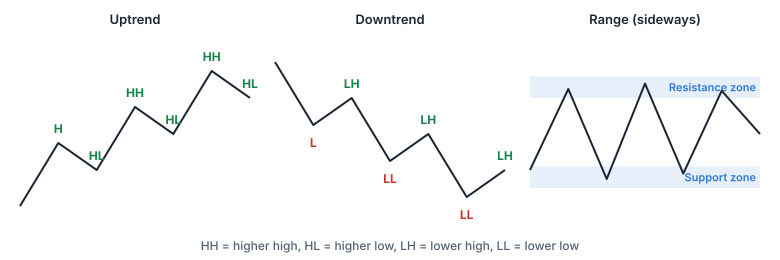

Antes de mirar ninguna vela concreta, los lectores de gráficos se hacen una pregunta más sencilla: **¿hacia dónde se mueve el mercado en conjunto?**

## Estructura del mercado

- **Tendencia alcista:** una serie de **máximos crecientes** y **mínimos crecientes**: cada subida llega más lejos que la anterior y cada retroceso se detiene más arriba.
- **Tendencia bajista:** **máximos decrecientes** y **mínimos decrecientes**.
- **Rango (mercado lateral):** el precio va y viene entre más o menos el mismo máximo y el mismo mínimo.

Una tendencia solo está clara en un **marco temporal** concreto: una tendencia alcista diaria puede contener varias tendencias bajistas horarias.

## Líneas de tendencia y canales

Una **línea de tendencia** une dos o más mínimos en una tendencia alcista (o máximos en una bajista). Un **canal** añade una línea paralela al otro lado. Ayudan a ver la pendiente de una tendencia, pero se dibujan a mano: dos personas pueden trazar líneas distintas en el mismo gráfico.

## Soporte y resistencia

- Un **soporte** es una zona de precios donde un precio que cae ha tendido a detenerse o a girar al alza.
- Una **resistencia** es una zona de precios donde un precio que sube ha tendido a detenerse o a girar a la baja.

Lugares habituales donde los operadores los buscan:

- **máximos y mínimos anteriores**, incluidos los máximos y mínimos de 52 semanas;
- **números redondos**, como 50 € o 100 €;
- **medias móviles** (lección 8);
- **líneas de tendencia**.

> [!NOTE] Zonas, no líneas
> Los precios rara vez giran exactamente en el mismo céntimo. Trata los soportes y las resistencias como **zonas** un poco por encima y por debajo de un nivel, y cuenta con que el precio las atraviese de vez en cuando.

**Cambio de papel:** una vez que se rompe claramente una resistencia, a menudo actúa como soporte en un retroceso posterior, y un soporte roto suele actuar como resistencia. Los operadores llaman **retest** a la vuelta al nivel antiguo.

## Rupturas, rupturas falsas y retrocesos

- **Ruptura (breakout):** el precio va con decisión más allá de una zona de soporte o de resistencia.
- **Ruptura falsa (fakeout):** el precio supera la zona y enseguida vuelve a meterse dentro. Las rupturas falsas son frecuentes, sobre todo en marcos temporales cortos y con poco volumen.
- **Retroceso (pullback):** un movimiento temporal en contra de la tendencia, por ejemplo de vuelta hacia una resistencia rota.

> [!EXAMPLE]
> Una acción ha girado a la baja cerca de los **50 €** tres veces en dos meses (resistencia). Un día cierra en **51,50 €**, con el doble de su volumen habitual. Algunos operadores lo toman como una ruptura; otros esperan a ver si los 50 € aguantan ahora como soporte en el siguiente retroceso. Si dos días después el precio vuelve a 48 €, la ruptura era falsa.

## El volumen como confirmación (y sus límites)

Los operadores suelen buscar **más volumen** en una ruptura como señal de participación real, y desconfían de una ruptura con poco volumen. El volumen ayuda, pero no garantiza que un movimiento vaya a continuar.

> [!MISTAKE] «Un soporte en 50 € significa que el precio no puede bajar de 50 €»
> Un soporte solo describe dónde entraron compradores **antes**. Cualquier noticia puede empujar el precio a través de él. Por eso los operadores deciden de antemano qué harán si el nivel se rompe.

Practica a dibujar líneas horizontales, líneas de tendencia y zonas en el [Laboratorio de gráficos](/charts/lab).

## Ideas clave

> [!TAKEAWAYS]
> - Tendencia alcista = máximos y mínimos crecientes; bajista = máximos y mínimos decrecientes; si no, un rango.
> - Los soportes y las resistencias son zonas donde el precio ya giró antes: máximos y mínimos anteriores, números redondos, medias móviles, líneas de tendencia.
> - Una resistencia rota suele convertirse en soporte (y al revés).
> - Las rupturas falsas son frecuentes; el volumen ayuda a confirmar, pero no garantiza nada.
