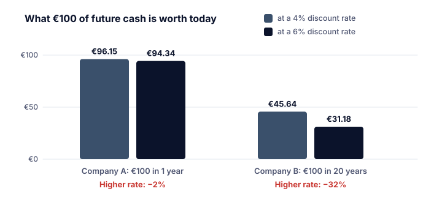

Pocas cosas mueven las bolsas con tanta fiabilidad como los tipos de interés. Cuando los mercados esperan nerviosos la decisión de un banco central, es porque los tipos de interés tocan casi todas las partes del valor de una acción.

El BCE describe cómo un cambio en sus tipos oficiales se extiende por la economía: a los tipos del mercado monetario, a los tipos que cobran y pagan los bancos, a las expectativas y a **los precios de los activos, como los precios en bolsa**, y al tipo de cambio. Para los accionistas hay tres canales principales.

## Canal 1: los beneficios de las empresas

- **Costes de financiación.** Las empresas con deuda pagan más intereses cuando suben los tipos, lo que reduce el beneficio (categoría I, lección 6).
- **Demanda.** El BCE explica que unos tipos más altos hacen menos atractivos los préstamos para consumir o invertir, así que hogares y empresas gastan menos. Una demanda menor significa menos ventas para muchas empresas.
- **Lo contrario** ocurre cuando bajan los tipos: crédito más barato y, a menudo, más gasto.

## Canal 2: la competencia de las inversiones seguras

Cuando las cuentas de ahorro y los bonos del Estado pagan un 0 %, las acciones parecen atractivas en comparación. Cuando las inversiones seguras pagan un 4 %, los inversores exigen más a las acciones antes de asumir el riesgo adicional.

> [!EXAMPLE] La rentabilidad del beneficio frente a la de un bono
> Una acción tiene un PER de 20, así que su **rentabilidad del beneficio** es 1 ÷ 20 = 5 %.
> - Si los bonos del Estado seguros rinden un 1 %, las acciones ofrecen 4 puntos porcentuales más (con más riesgo).
> - Si los bonos rinden un 4 %, el extra es solo de 1 punto porcentual. Algunos inversores se pasan a los bonos, lo que puede empujar a la baja los precios de las acciones hasta que la rentabilidad del beneficio vuelva a parecer atractiva.

Es una comparación aproximada, no una regla de valoración: los beneficios pueden crecer, mientras que el interés de un bono es fijo.

## Canal 3: el valor del efectivo futuro

El *Owner's Manual* de Berkshire Hathaway define el valor intrínseco como el valor **descontado** del efectivo que puede producir un negocio, y señala que la estimación debe cambiar cuando cambian los tipos de interés. Un tipo de interés más alto significa una tasa de descuento más alta, así que el efectivo que se espera en el futuro vale menos hoy (categoría I, lección 8).

> [!EXAMPLE] Efectivo cercano y efectivo lejano
> Dos empresas esperan pagar 100 € cada una.
> - La **empresa A** lo paga dentro de 1 año. Con una tasa de descuento del 4 %, vale 100 ÷ 1,04 = **96,15 €**; al 6 %, vale 100 ÷ 1,06 = **94,34 €**. Una caída de alrededor del **2 %**.
> - La **empresa B** lo paga dentro de 20 años. Al 4 %: 100 ÷ 1,04²⁰ = **45,64 €**; al 6 %: 100 ÷ 1,06²⁰ = **31,18 €**. Una caída de alrededor del **32 %**.
>
> La misma subida de tipos perjudica mucho más a los flujos de caja lejanos.

Por eso las **empresas de crecimiento**, cuyos beneficios se esperan sobre todo en el futuro, suelen ser más sensibles a los tipos de interés que las empresas maduras que pagan hoy dividendos estables.

## Los bonos y las acciones pueden caer a la vez

Cuando los tipos de interés suben con fuerza, los bonos existentes pierden valor (su interés fijo resulta menos atractivo), y las acciones también pueden caer. En los datos de EE. UU. de Damodaran, **2022** fue uno de esos años: el S&P 500 perdió un **18,0 %** y los bonos del Tesoro de EE. UU. a 10 años un **17,8 %**. En la zona del euro, el BCE subió su tipo de la facilidad de depósito del **−0,50 %** al **2,00 %** durante 2022, en cuatro pasos de julio a diciembre (tipos de interés oficiales del BCE).

> [!NOTE] Las expectativas mueven los precios, no solo las decisiones
> El BCE subraya que las expectativas sobre futuros cambios de tipos afectan a los tipos de interés a medio y largo plazo. Los mercados suelen moverse cuando cambian las **perspectivas** de los tipos, antes de que se tome ninguna decisión. Una subida de tipos que todo el mundo esperaba puede apenas mover los precios.

> [!MISTAKE] «Las bajadas de tipos siempre son buenas para las acciones»
> Los bancos centrales suelen bajar los tipos porque la economía se está debilitando. Entre septiembre de 2007 y diciembre de 2008, la Fed bajó su tipo oficial del 5,25 % al 0–0,25 %, y aun así el S&P 500 siguió cayendo hasta marzo de 2009 (Federal Reserve History; categoría K). Por qué cambian los tipos importa tanto como la dirección.

## Ideas clave

> [!TAKEAWAYS]
> - Los tipos de interés afectan al precio de las acciones a través de los beneficios, de la competencia de las inversiones seguras y del descuento del efectivo futuro.
> - Unos tipos más altos reducen sobre todo el valor actual de los flujos de caja lejanos, así que las acciones de crecimiento suelen ser más sensibles a los tipos.
> - Los bonos y las acciones pueden caer a la vez cuando los tipos suben con fuerza, como en 2022.
> - Los mercados reaccionan a los cambios en los tipos esperados, a menudo antes de las decisiones.
> - Las bajadas de tipos en plena recesión no garantizan que suban los precios.
