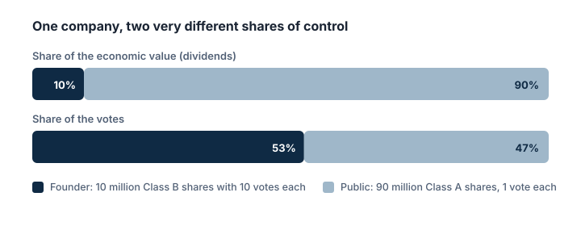

Dans le cas le plus simple, toutes les actions d'une entreprise sont identiques : une action, une voix, le même dividende. Mais certaines entreprises créent **plusieurs catégories** d'actions, souvent appelées **actions A** et **actions B** (ou d'autres lettres), avec des droits différents.

## Ce qui peut différer d'une catégorie à l'autre

- **Les droits de vote :** une catégorie peut avoir une voix par action, une autre dix voix, une autre aucune.
- **Les dividendes :** une catégorie peut recevoir un dividende plus élevé ou prioritaire (comme les actions de préférence).
- **La négociabilité :** une catégorie peut être cotée en Bourse, une autre détenue en privé par les fondateurs.

Les lettres elles-mêmes ne signifient rien : les « actions A » ont plus de voix dans une entreprise et moins dans une autre. Seuls les statuts de l'entreprise et son prospectus indiquent ce que reçoit chaque catégorie.

## Les structures à deux catégories

Le cas le plus débattu est la **structure à deux catégories d'actions** (dual class) : les fondateurs et les initiés détiennent des actions avec **plus de voix par action** que celles vendues au public.

> [!EXAMPLE]
> Une entreprise compte **100 millions** d'actions :
>
> - **90 millions d'actions A** détenues par le public, à **1 voix** chacune = 90 millions de voix
> - **10 millions d'actions B** détenues par le fondateur, à **10 voix** chacune = 100 millions de voix
>
> Si les deux catégories ont les mêmes droits aux dividendes, le fondateur ne possède que **10 %** de la valeur économique, mais contrôle 100 ÷ 190 ≈ **53 %** des voix, soit la majorité.

## Pourquoi c'est controversé

- **Pour :** les partisans estiment que des fondateurs visionnaires peuvent se concentrer sur le long terme sans être bousculés par des actionnaires de court terme.
- **Contre :** les critiques, dont l'Investor Advocate de la SEC dans un discours de 2019, estiment que cela permet à des initiés de contrôler une entreprise avec une petite participation, réduit la responsabilité de la direction et laisse aux actionnaires du public peu de poids si les choses tournent mal.

> [!AUSTRIA]
> Le segment phare de la Bourse de Vienne, le **prime market**, n'admet en principe que des **actions ordinaires**. Les actions de préférence, par exemple, n'y figurent pas.

> [!MISTAKE] « Je possède des actions, donc j'ai mon mot à dire »
> Dans une entreprise à deux catégories d'actions, vous pouvez posséder une part importante de la valeur économique et presque aucun pouvoir de vote. Vérifiez les catégories d'actions dans le prospectus ou le rapport annuel avant de supposer que vous avez de l'influence.

## À retenir

> [!TAKEAWAYS]
> - Les entreprises peuvent émettre plusieurs catégories d'actions avec des voix, des dividendes ou une négociabilité différents.
> - Les lettres des catégories n'ont pas de sens standard ; lisez les documents de l'entreprise.
> - Les structures à deux catégories permettent aux fondateurs de contrôler une entreprise avec une minorité des actions.
> - Elles font débat : vision de long terme contre moindre responsabilité envers les actionnaires du public.
