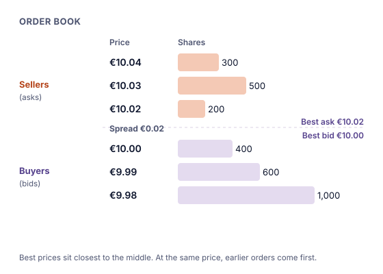

Au cœur de toute Bourse électronique se trouve le **carnet d'ordres** : la liste de tous les ordres d'achat et de vente en attente d'exécution. La Bourse de Vienne l'appelle le cœur de la Bourse informatisée.

## Prix acheteur et prix vendeur

- Un **prix acheteur** (bid ; en allemand : Geld) correspond à un ordre d'**achat** : « je paierai au plus ce prix ».
- Un **prix vendeur** (ask ou offer ; en allemand : Brief) correspond à un ordre de **vente** : « je vendrai au moins à ce prix ».

Le prix acheteur le plus élevé est le **meilleur prix acheteur** ; le prix vendeur le plus bas est le **meilleur prix vendeur**. La différence entre les deux est la **fourchette acheteur-vendeur** (le spread).

## La priorité prix-temps

Les ordres du carnet sont classés selon deux règles :

1. **D'abord le prix :** le meilleur prix passe en premier. Pour les acheteurs, c'est le prix acheteur le plus élevé ; pour les vendeurs, le prix vendeur le plus bas.
2. **Ensuite l'heure :** parmi les ordres au même prix, celui qui est arrivé en premier passe en premier.

C'est ce qu'on appelle la **priorité prix-temps**. Elle récompense ceux qui proposent le meilleur prix et, à prix égal, ceux qui étaient là les premiers.

## Comment une transaction a lieu

Tant que le meilleur prix acheteur est inférieur au meilleur prix vendeur, rien ne se passe : acheteurs et vendeurs ne sont pas d'accord. Une transaction a lieu quand un nouvel ordre **franchit** la fourchette.

> [!EXAMPLE]
> Le carnet ressemble à l'image ci-dessus : meilleur prix acheteur 10,00 €, meilleur prix vendeur 10,02 €.
>
> Vous envoyez un **ordre d'achat de 300 actions jusqu'à 10,03 €**. Le moteur d'appariement :
>
> 1. Prend d'abord l'offre la moins chère : **200 actions à 10,02 €**.
> 2. Puis la suivante : **100 actions à 10,03 €** (sur les 500 disponibles à ce prix).
>
> Vous avez acheté 300 actions pour 200 × 10,02 € + 100 × 10,03 € = 2 004 € + 1 003 € = **3 007 €**, soit une moyenne d'environ 10,023 € par action. Le carnet affiche désormais 400 actions encore proposées à 10,03 €, et le dernier cours négocié est de 10,03 €.

Notez qu'un gros ordre « traverse » plusieurs niveaux de prix ; c'est pourquoi les gros ordres peuvent faire bouger le cours.

## Ce que dit la fourchette

- Une **fourchette étroite** (par ex. 10,00 € / 10,01 €) signifie généralement de nombreux acheteurs et vendeurs actifs : l'action est **liquide**.
- Une **fourchette large** (par ex. 4,80 € / 5,20 €) signifie peu de participants : négocier coûte plus cher, car acheter au prix vendeur et revendre aussitôt au prix acheteur ferait perdre la fourchette.

> [!EXAMPLE]
> Prix acheteur 4,80 €, prix vendeur 5,20 €. Si vous achetez 100 actions à 5,20 € et les revendez aussitôt à 4,80 €, vous perdez 100 × 0,40 € = **40 €**, avant tous frais. C'est le coût de la fourchette.

> [!MISTAKE] « Le cours affiché est le prix que j'obtiendrai »
> Le « dernier cours » est le prix de la dernière transaction. Quand vous achetez maintenant, vous payez généralement le **prix vendeur** actuel ; quand vous vendez, vous obtenez le **prix acheteur** actuel. Et un gros ordre peut n'être exécuté qu'en partie au meilleur prix.

## À retenir

> [!TAKEAWAYS]
> - Le carnet d'ordres recueille tous les ordres d'achat (prix acheteurs) et de vente (prix vendeurs) en attente.
> - Les ordres sont classés selon la priorité prix-temps : d'abord le meilleur prix, puis le plus ancien.
> - Une transaction a lieu quand un ordre franchit la fourchette ; les gros ordres peuvent prendre plusieurs niveaux de prix.
> - La fourchette est un coût de transaction ; une fourchette étroite signale généralement une action liquide.
