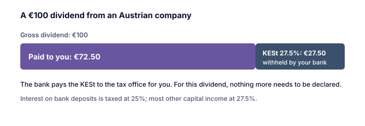

> [!VERIFY] Les règles fiscales changent
> Ceci est un aperçu pédagogique simplifié destiné aux particuliers résidant en Autriche qui détiennent leurs placements dans leur patrimoine privé. Les taux et les règles changent. Vérifiez les règles en vigueur auprès du ministère fédéral des Finances (BMF), de votre banque ou d'un conseiller fiscal avant d'agir.

## Les taux spéciaux

Selon le § 27a EStG et le BMF, la plupart des revenus de capitaux sont imposés à un **taux spécial**, séparément de vos autres revenus, si bien qu'ils ne **font pas grimper** le taux progressif de l'impôt sur le revenu appliqué à votre salaire :

| Revenu | Taux spécial |
|---|---:|
| Intérêts des comptes d'épargne et des comptes courants bancaires | **25 %** |
| La plupart des autres revenus de capitaux : dividendes, intérêts d'obligations, plus-values de cession d'actions, de fonds et de dérivés titrisés | **27,5 %** |

> [!EXAMPLE] Un dividende d'une entreprise autrichienne
> Vous recevez un dividende brut de **100 €** d'une société anonyme autrichienne. **27,50 €** de KESt sont retenus ; **72,50 €** vous sont versés. Il n'y a rien d'autre à déclarer pour ce dividende.

## La KESt : un impôt retenu à la source

Le BMF explique que, si un dépositaire ou un agent payeur **autrichien**, comme une banque autrichienne, intervient, l'impôt est généralement perçu par **prélèvement** : la banque retient l'**impôt sur les revenus du capital (Kapitalertragsteuer, KESt)** et le verse au fisc. Pour les dividendes autrichiens, c'est la société distributrice qui le retient.

Pour la plupart de ces revenus, la retenue **solde** l'impôt sur le revenu (*Endbesteuerung*) : vous n'avez pas à les inclure dans votre déclaration. Selon le BMF, cela concerne en particulier :

- les intérêts des dépôts bancaires (25 %) et des obligations (27,5 %) ;
- les dividendes d'actions (27,5 %) ;
- les plus-values de cession d'actions et de dérivés titrisés (27,5 %).

Depuis le 1er avril 2012, les plus-values de cession de biens de capital sont aussi soumises à la KESt (pour le détail concernant les titres plus anciens, voir la leçon 3).

## Quand vous devez déclarer vous-même

Si aucune KESt n'est prélevée, le revenu doit figurer dans votre déclaration, toujours au taux spécial. Le BMF cite en particulier :

- les intérêts d'une épargne placée dans une banque **étrangère** ;
- les plus-values sur des placements détenus sur un **compte-titres étranger** (leçon 6) ;
- la cession d'une part de société à responsabilité limitée (GmbH), qui n'est pas détenue sur un compte-titres.

Certains revenus de capitaux, comme les prêts entre particuliers ou les véritables participations tacites, sont toujours imposés au **barème progressif normal**.

## L'option pour les faibles revenus (Regelbesteuerungsoption)

Si votre revenu total est faible, le barème progressif normal appliqué à l'ensemble de vos revenus peut être inférieur à 27,5 % sur les revenus de capitaux. Le BMF explique que vous pouvez alors demander, dans votre déclaration, que vos revenus de capitaux soient imposés au **barème normal** (§ 27a, paragraphe 5, EStG) : c'est l'option pour le barème normal. Elle ne s'applique qu'à **l'ensemble** de vos revenus de capitaux, et des règles particulières s'appliquent dans certains cas, par exemple pour les conjoints de personnes à revenu unique.

## Ce qui ne peut pas être déduit

Le BMF souligne que, pour les revenus imposés aux taux spéciaux, **les frais ne peuvent pas être déduits**, même si vous choisissez l'imposition au barème normal. Exemples : frais de financement, frais de transaction du vendeur, droits de garde, frais de déplacement pour se rendre à une assemblée générale.

> [!MISTAKE] Croire que 27,5 % s'applique à tout
> Les intérêts des dépôts bancaires sont imposés à 25 %, et certains revenus de capitaux (comme les prêts entre particuliers) au barème progressif normal. Les cryptomonnaies font partie des revenus de capitaux à 27,5 % depuis le 1er mars 2022 (leçon 7).

## À retenir

> [!TAKEAWAYS]
> - En Autriche, la plupart des revenus de capitaux sont imposés à un taux spécial de 27,5 % ; les intérêts des dépôts bancaires à 25 %.
> - Une banque ou une entreprise autrichienne retient généralement l'impôt sous forme de KESt, ce qui le solde en principe.
> - Sans retenue de KESt (par exemple sur un compte étranger), vous devez déclarer le revenu.
> - Les personnes à faible revenu peuvent demander que tous leurs revenus de capitaux soient imposés au barème progressif normal.
> - Les frais comme les droits de garde et les frais de transaction ne sont pas déductibles.
