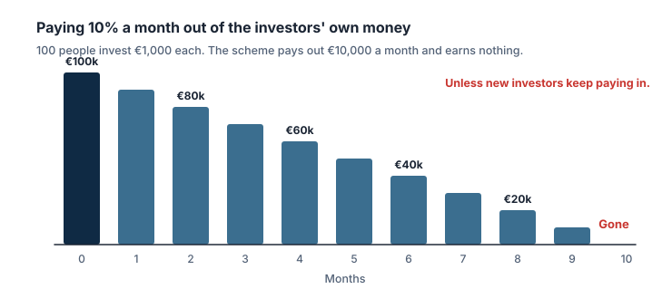

## Les systèmes de Ponzi

Investor.gov définit un **système de Ponzi** comme une fraude à l'investissement qui **paie les investisseurs existants avec les fonds collectés auprès des nouveaux**. Les organisateurs promettent souvent d'investir l'argent et de dégager des **rendements élevés avec peu ou pas de risque**, mais dans bien des cas ils ne l'investissent pas du tout. Ils s'en servent pour payer les investisseurs précédents et en gardent une partie.

Comme il n'y a que peu ou pas de gains réels, un système de Ponzi a besoin d'un **flux constant d'argent frais**. Quand il devient difficile de recruter de nouveaux investisseurs, ou que de nombreux investisseurs veulent récupérer leur argent en même temps, il **s'effondre**. Le nom vient de **Charles Ponzi**, qui a escroqué des investisseurs dans les années 1920 avec un montage de spéculation sur les timbres-poste.

> [!EXAMPLE] L'arithmétique de l'effondrement
> Un montage promet 10 % par mois. 100 personnes investissent 1 000 € chacune : 100 000 €. Verser 10 % par mois coûte 10 000 € par mois. Sans gains réels, l'argent initial a disparu au bout de 10 mois, à moins que de plus en plus de nouveaux investisseurs ne rejoignent le montage. Plus il grossit, plus il lui faut d'argent frais, et plus la perte est grande quand il s'arrête.

## Les signaux d'alerte de la SEC

Investor.gov énumère des signes communs à de nombreux systèmes de Ponzi :

- **Des rendements élevés avec peu ou pas de risque.** Méfiez-vous fortement de tout ce qui est « garanti ».
- **Des rendements trop réguliers,** quelles que soient les conditions de marché.
- **Des placements non enregistrés** et **des vendeurs non agréés.**
- **Des stratégies secrètes et complexes** que vous ne pouvez pas comprendre pleinement ou sur lesquelles vous n'obtenez pas d'informations.
- **Des problèmes de documents,** comme des erreurs dans les relevés de compte.
- **Des difficultés à recevoir des paiements** ou à récupérer son argent ; les promoteurs peuvent proposer des rendements encore plus élevés pour que vous restiez.

## Les systèmes pyramidaux

Dans un **système pyramidal**, l'argent versé par les nouvelles recrues sert à payer les participants précédents. Investor.gov note que les promoteurs peuvent se donner beaucoup de mal pour faire passer le système pour une activité légitime, comme un programme de marketing de réseau, et le promouvoir via les réseaux sociaux, des publicités, des sites et des présentations. Un jour, le système devient trop grand, l'argent frais ne suffit plus, et **la plupart des investisseurs perdent leur argent**. Les caractéristiques citées par Investor.gov :

- **L'accent mis sur le recrutement :** vous gagnez davantage en faisant adhérer d'autres personnes qu'en vendant des produits.
- **Aucun véritable produit ou service,** ou des « produits » difficiles à évaluer.
- **Des promesses de rendements élevés en peu de temps.**

> [!TIP] La question clé
> D'où vient exactement l'argent de mes rendements ? Si la réponse honnête est « des personnes qui adhèrent après moi », c'est un montage qui finira forcément par échouer.

## En Autriche

Quiconque propose des services bancaires, financiers ou d'investissement en Autriche doit être agréé par la FMA, qui publie des mises en garde sur les prestataires non agréés (leçon 3). Vérifiez avant d'investir ; une mise en garde est un signal d'arrêt clair.

## À retenir

> [!TAKEAWAYS]
> - Un système de Ponzi paie les investisseurs précédents avec l'argent des nouveaux et s'effondre quand les entrées s'arrêtent.
> - Signaux d'alerte : rendements élevés avec peu de risque, rendements trop réguliers, vendeurs non agréés, problèmes de documents, difficultés à récupérer son argent.
> - Les systèmes pyramidaux récompensent le recrutement plutôt que de vrais produits ou rendements.
> - Demandez d'où viennent les rendements ; « des nouveaux membres » signifie un effondrement certain.
> - En Autriche, vérifiez les prestataires dans la base de données et la liste des mises en garde de la FMA.
