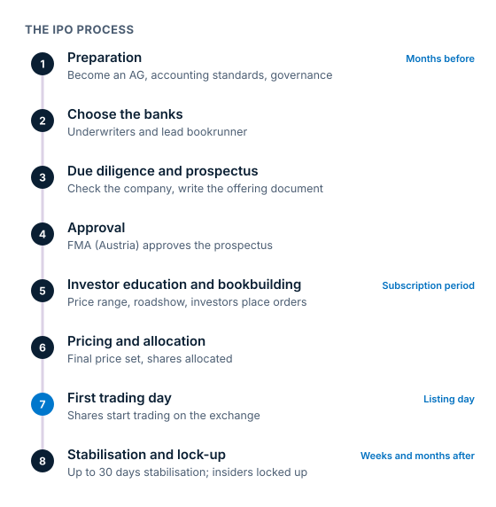

### Che cosa succede

1. **Preparazione:** bilanci, governance e, in Austria, trasformazione in AG.
2. **Scelta delle banche:** i **sottoscrittori** (underwriter), guidati da un **bookrunner**.
3. **Due diligence e prospetto:** il documento ufficiale dell'offerta.
4. **Approvazione:** da parte dell'autorità di vigilanza nazionale nell'UE (negli Stati Uniti, registrazione presso la SEC).
5. **Forchetta di prezzo** dai colloqui con gli investitori, poi il **roadshow** e il **bookbuilding**: gli investitori indicano quante azioni vogliono e fino a quale prezzo.
6. **Fissazione del prezzo e assegnazione:** la società fissa il prezzo finale; se l'offerta è **sottoscritta in eccesso**, gli investitori ricevono solo una parte di quanto hanno ordinato.
7. **Greenshoe e stabilizzazione:** azioni aggiuntive e sostegno al prezzo nelle prime settimane.
8. **Giorno della quotazione:** il primo scambio, spesso dopo un'asta di apertura. Il prezzo può «schizzare» sopra il prezzo d'offerta o «rompere» al di sotto.
9. **Lock-up:** gli insider si impegnano a non vendere per un periodo dopo l'IPO.

Un'IPO può vendere **azioni primarie** (azioni nuove; il denaro va alla società) e **azioni secondarie** (azioni esistenti; il denaro va ai venditori).

### Chi è coinvolto

La società, i suoi proprietari, le banche sottoscrittrici, avvocati, revisori, l'autorità di vigilanza (in Austria la **FMA**), investitori istituzionali e privati, e la Borsa.

### Esempio con i numeri

> [!EXAMPLE]
> Una società con **50 milioni di azioni** ne vende **15 milioni** a **20 €**.
>
> - Denaro raccolto: 15 mln × 20 € = **300 milioni di €**
> - Capitalizzazione di mercato: 50 mln × 20 € = **1 miliardo di €**
> - Flottante: 15 mln ÷ 50 mln = **30%**
>
> Secondo le regole UE, la greenshoe può essere al massimo il **15%** dell'offerta originaria: qui fino a 2,25 milioni di azioni aggiuntive.

> [!AUSTRIA]
> La **FMA** approva il prospetto dopo averne verificato completezza, coerenza e comprensibilità, non la correttezza. Il prime market richiede un flottante di almeno il **25%**, del valore di almeno **20 milioni di €**.

> [!NOTE] Negli Stati Uniti
> Le società registrano l'offerta presso la SEC, di solito con il **Form S-1**. Secondo il sito della SEC per gli investitori, la maggior parte dei lock-up dura **180 giorni**, anche se le condizioni variano.

Prova tu: nel simulatore di bookbuilding qui sotto, fissa il prezzo d'offerta di un'IPO immaginaria e guarda come cambiano domanda, copertura e denaro raccolto.
