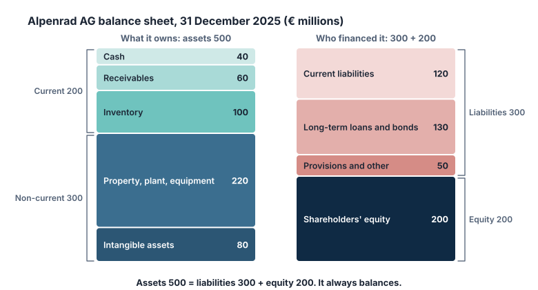

Lo **stato patrimoniale** (in tedesco: *Bilanz*) è un'**istantanea** di una società a una certa data, di solito l'ultimo giorno dell'esercizio. Elenca ciò che la società possiede (attività), ciò che deve (passività) e ciò che resta ai proprietari (patrimonio netto).

## L'equazione contabile

Ogni stato patrimoniale segue una regola:

**Attività = Passività + Patrimonio netto**

I due lati devono sempre essere uguali, cioè «in equilibrio». Non è un caso: tutto ciò che una società possiede è stato pagato o con denaro preso a prestito (passività) o con il denaro dei proprietari (patrimonio netto, compresi gli utili trattenuti nell'azienda).

- Le **attività** sono beni di valore che la società possiede o controlla: liquidità, denaro che i clienti le devono ancora (crediti), magazzino, stabilimenti, macchinari e beni immateriali come brevetti, marchi e software.
- Le **passività** sono importi che la società deve: prestiti bancari, obbligazioni, denaro dovuto ai fornitori (debiti commerciali), salari, imposte e impegni a consegnare beni o servizi già pagati dai clienti.
- Il **patrimonio netto** è ciò che resterebbe se la società vendesse tutte le sue attività ai valori di bilancio e pagasse tutte le sue passività. La guida della SEC osserva che a volte viene chiamato capitale o valore netto.

## Correnti e non correnti

Entrambi i lati sono suddivisi in base al tempo:

- Le **attività correnti** dovrebbero trasformarsi in liquidità entro un anno (liquidità, crediti, magazzino). Le **attività non correnti** richiedono più tempo o servono a gestire l'attività (edifici, macchinari, beni immateriali).
- Le **passività correnti** scadono entro un anno. Le **passività a lungo termine (non correnti)** scadono più tardi.

## Esempio svolto: Alpenrad AG

Alpenrad AG è il nostro produttore austriaco di biciclette inventato. Il suo stato patrimoniale al 31 dicembre 2025, in milioni di euro:

| Attività | M€ | Passività e patrimonio netto | M€ |
|---|---:|---|---:|
| Liquidità | 40 | Debiti verso fornitori | 70 |
| Crediti | 60 | Debiti bancari a breve termine | 30 |
| Magazzino | 100 | Altre passività correnti | 20 |
| **Attività correnti** | **200** | **Passività correnti** | **120** |
| Immobili, impianti e macchinari | 220 | Prestiti a lungo termine e obbligazioni | 130 |
| Attività immateriali | 80 | Fondi e altre passività | 50 |
| **Attività non correnti** | **300** | **Totale passività** | **300** |
| | | **Patrimonio netto** | **200** |
| **Totale attività** | **500** | **Totale passività e patrimonio netto** | **500** |

Verifica: 300 + 200 = 500. È in equilibrio.

## Numeri che puoi calcolare

**Capitale circolante** = attività correnti − passività correnti. La guida della SEC lo descrive come il denaro che resterebbe se una società pagasse le passività correnti con le attività correnti.

> [!EXAMPLE] Capitale circolante e current ratio
> Il capitale circolante di Alpenrad = 200 − 120 = **80 M€**.
>
> Il **current ratio** = attività correnti ÷ passività correnti = 200 ÷ 120 ≈ **1,67**. Alpenrad ha circa 1,67 € di attività a breve termine per ogni euro di impegni a breve termine.

Il **valore contabile** è un altro nome del patrimonio netto. Diviso per il numero di azioni, dà il **valore contabile per azione**.

> [!EXAMPLE] Valore contabile per azione
> Alpenrad ha 20 milioni di azioni. Valore contabile per azione = 200 M€ ÷ 20 M = **10 €**.
>
> Se l'azione è scambiata a 24 €, il mercato valuta la società 2,4 volte il suo valore contabile. La lezione 7 spiega questo rapporto prezzo/valore contabile.

L'**indebitamento netto** = debito fruttifero di interessi − liquidità. Mostra quanto debito resterebbe se la società usasse tutta la sua liquidità per rimborsarlo.

> [!EXAMPLE] Indebitamento netto
> Debito fruttifero di interessi = debiti bancari a breve termine 30 + prestiti a lungo termine e obbligazioni 130 = 160 M€.
> Indebitamento netto = 160 − 40 di liquidità = **120 M€**.

## Che cosa lo stato patrimoniale non mostra

- **È un solo momento.** La guida della SEC sottolinea che mostra la situazione alla fine del periodo, non i flussi durante il periodo. Una società può sistemare la propria liquidità appena prima della data di chiusura.
- **I valori contabili non sono valori di mercato.** Uno stabilimento acquistato 30 anni fa può essere iscritto a un valore basso. Un marchio costruito in decenni di pubblicità può non comparire affatto: secondo gli IFRS, marchi, elenchi clienti e voci simili generati internamente non sono rilevati come attività immateriali (IAS 38).
- **L'avviamento.** Quando una società ne acquista un'altra pagando più del valore delle sue attività nette identificabili, il resto del prezzo viene registrato come **avviamento**, un'attività immateriale (IFRS 3). Secondo lo IAS 36, l'avviamento è sottoposto a una verifica per **svalutazione** (impairment test): se l'attività acquisita vale ora meno del suo valore contabile, l'avviamento viene svalutato, il che riduce l'utile e il patrimonio netto.

> [!MISTAKE] «Patrimonio netto negativo significa fallimento»
> Non necessariamente. Alcune società redditizie hanno un patrimonio netto contabile negativo perché nel corso degli anni hanno distribuito in dividendi e riacquisti di azioni proprie più di quanto hanno guadagnato. Un patrimonio netto negativo è un motivo per guardare meglio, non un verdetto automatico. Allo stesso modo, un patrimonio netto positivo elevato non garantisce la sicurezza se le attività sono difficili da vendere.

> [!TIP] Confronta almeno due date
> Un solo stato patrimoniale dice poco. Confronta quest'anno con l'anno scorso: il debito è cresciuto più delle attività? Il magazzino si è accumulato mentre le vendite restavano ferme? Le variazioni sono spesso più rivelatrici dei livelli.

## Punti chiave

> [!TAKEAWAYS]
> - Attività = passività + patrimonio netto, sempre.
> - Corrente significa entro un anno; non corrente significa oltre.
> - Capitale circolante = attività correnti − passività correnti; valore contabile = patrimonio netto.
> - Indebitamento netto = debito fruttifero di interessi − liquidità.
> - I valori contabili sono valori contabili storici, non il prezzo a cui si venderebbe l'azienda.
