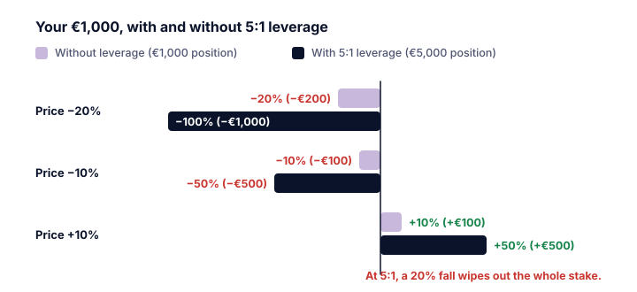

La **leva finanziaria** consiste nel controllare una posizione più grande del proprio denaro, usando fondi presi a prestito o un derivato. Una leva di 5:1 significa che 1.000 € di denaro tuo controllano una posizione da 5.000 €.

## Guadagni e perdite vengono moltiplicati

> [!EXAMPLE] Lo stesso movimento del 10%, con e senza leva
> Hai **1.000 €**.
>
> | | Senza leva | Leva 5:1 |
> |---|---:|---:|
> | Dimensione della posizione | 1.000 € | 5.000 € |
> | Prezzo **+10%** | +100 € (+10%) | +500 € (**+50%**) |
> | Prezzo **−10%** | −100 € (−10%) | −500 € (**−50%**) |
> | Prezzo **−20%** | −200 € (−20%) | −1.000 € (**−100%**) |
>
> Con una leva di 5:1, un calo del 20% azzera tutta la tua posta. Con 20:1 basta un calo del 5%.

La regola: **variazione % del tuo denaro ≈ variazione % del prezzo × leva** (al lordo dei costi).

In più, il denaro preso a prestito costa **interessi**, che si pagano sia che l'operazione vinca sia che perda.

## Comprare a margine

Investor.gov descrive un **conto a margine** come un conto presso un broker in cui il broker ti presta liquidità, usando il tuo conto come garanzia, per comprare titoli. Aumenta il tuo potere d'acquisto, ma ti espone anche a **perdite più grandi**.

### La margin call

Se i prezzi scendono, Investor.gov avverte che il tuo broker può chiederti di versare altra liquidità o altri titoli **immediatamente**, oppure **vendere i tuoi titoli senza avvisarti prima**. È il broker a decidere quali titoli vendere. Anche se ti dice che hai qualche giorno, potrebbe vendere prima.

> [!EXAMPLE] Costretto a uscire sul fondo
> Compri azioni per 10.000 € con 5.000 € di denaro tuo e un prestito di 5.000 €. Il tuo broker richiede che il tuo capitale resti almeno il 30% della posizione.
> - Le azioni scendono del 30% a 7.000 €. Il tuo capitale è 7.000 − 5.000 = 2.000 €, solo il **29%** della posizione.
> - Margin call: versa altro denaro, o il broker vende. Se vende a 7.000 €, ti restano **2.000 €**: una perdita del 60% sul tuo denaro a fronte di un calo del 30%.
> - Se poi le azioni si riprendono, non le possiedi più.

> [!ANIMATION] margin-call
> Un calo del 30% porta il tuo capitale da 5.000 € a 2.000 €, cioè il 29% della posizione, sotto il minimo del 30% del broker: una margin call.

## Il margine nei derivati

Con i future e altri derivati, il **margine** è la garanzia che versi. Il lessico della Wiener Börse distingue il **margine iniziale**, versato per aprire una posizione in future, e il **margine di variazione**, che regola guadagni e perdite **ogni giorno**. Una posizione in perdita richiede denaro fresco ogni giorno, il che può costringerti a chiuderla.

## La leva nella storia

Federal Reserve History descrive come, negli anni Venti, chi comprava azioni versasse di solito circa il 10% del prezzo e prendesse a prestito il resto. Quando i prezzi scesero nel 1929, il denaro preso a prestito trasformò un calo in un tracollo (categoria K).

> [!WARNING] La leva toglie il tempo
> Chi investe senza leva in un indice ampio può aspettare una ripresa. Chi usa la leva può essere costretto a vendere prima che arrivi. Questa differenza trasforma cali temporanei in perdite permanenti.

> [!MISTAKE] «Userò uno stop-loss, quindi non posso perdere più di quanto ho previsto»
> Nei mercati frenetici i prezzi possono saltare oltre un livello di stop, soprattutto durante la notte o all'apertura (gap, categoria J). Con la leva, un gap può costare più di quanto avevi previsto, e con alcuni prodotti più di quanto hai investito.

## Punti chiave

> [!TAKEAWAYS]
> - La leva moltiplica guadagni e perdite: risultato % ≈ movimento % del prezzo × leva.
> - Con 5:1, un calo del 20% azzera tutta la posta.
> - Investor.gov: in una margin call, un broker può vendere i tuoi titoli senza preavviso.
> - Nei future, il margine di variazione giornaliero può richiedere denaro nuovo ogni giorno.
> - La leva può costringerti a vendere prima di una ripresa.
