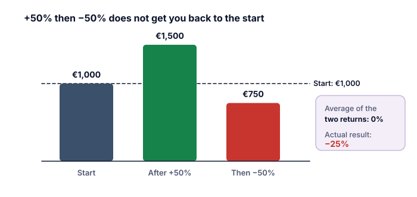

La volatilità (lezione 2) misura le oscillazioni in entrambe le direzioni. A molti investitori importa di più un'altra domanda: **quanto potrei perdere dal massimo, e quanto tempo ci vorrebbe per tornarci?**

## Il drawdown massimo

Il **drawdown** è il calo da un picco precedente a un minimo successivo (categoria K). Il **drawdown massimo** è il calo più grande di questo tipo in un periodo.

> [!EXAMPLE] I drawdown nella storia
> - Dow Jones, da settembre 1929 a luglio 1932: **−89%** (Federal Reserve History).
> - S&P 500 con i dividendi, misurato solo sui valori di fine anno: circa **−65%** all'inizio degli anni Trenta (dati di Damodaran, calcolo nostro). I cali durante l'anno sono stati più profondi.
> - Nikkei 225, da fine 1989 a ottobre 1998: da 38.915 a 12.879 yen, circa **−67%** (Nikkei Indexes).

## Per riprendersi servono guadagni più grandi

| Drawdown | Guadagno necessario per riprendersi |
|---:|---:|
| −20% | +25% |
| −35% | +54% |
| −50% | +100% |
| −65% | +186% |
| −89% | +809% |

Formula: guadagno necessario = 1 ÷ (1 − perdita) − 1. Al 7% annuo, riprendersi da −50% richiede più di 10 anni; al 10% annuo, circa 7 anni.

## Il volatility drag: perché le oscillazioni costano denaro

La **media** dei rendimenti annui non coincide con ciò che il tuo denaro guadagna davvero.

> [!EXAMPLE] +50%, poi −50%
> 1.000 € salgono del 50% a 1.500 €, poi scendono del 50% a **750 €**.
> Il rendimento medio aritmetico è (50% − 50%) ÷ 2 = **0%**. Il tuo risultato effettivo: **−25%**.

Il rendimento che il tuo denaro guadagna davvero nel tempo è il **rendimento composto (geometrico)**. Più i rendimenti sono volatili, più grande è lo scarto sotto la media aritmetica. Questo scarto viene spesso chiamato **volatility drag** (freno della volatilità).

> [!EXAMPLE] Lo scarto nei dati reali
> S&P 500, 1928–2025 (Damodaran, calcolo nostro):
> - Media aritmetica dei rendimenti annui: circa **11,9%**.
> - Rendimento annuo composto: circa **10,0%**.
>
> La differenza di 1,9 punti è il costo delle oscillazioni.

Un'approssimazione utile: **rendimento composto ≈ rendimento medio − ½ × volatilità²**. Con 11,9% e una volatilità del 19,4%: 11,9% − ½ × 19,4%² ≈ 11,9% − 1,9% = 10,0%.

## Perché ti riguarda

1. **Evitare perdite profonde aiuta la capitalizzazione.** Ridurre la profondità dei cali può contare quanto inseguire rendimenti più alti.
2. **La leva peggiora molto il drag** (categoria N). Una volatilità più alta aumenta lo scarto; gli ETF a leva ne soffrono ogni giorno (categoria H).
3. **Il tuo orizzonte temporale deve coprire la ripresa.** Se ti serve il denaro tra tre anni, un drawdown che richiede sette anni per essere recuperato è una perdita reale (categoria M).

> [!MISTAKE] Giudicare un fondo dal suo rendimento medio
> Un fondo che pubblicizza un «rendimento medio» elevato può aver guadagnato molto meno nella pratica se i suoi rendimenti oscillavano molto. Guarda il rendimento composto, e il drawdown massimo.

## Punti chiave

> [!TAKEAWAYS]
> - Il drawdown massimo è il calo più grande da un picco; per riprendersi serve un guadagno percentuale più grande.
> - −50% richiede +100% per riprendersi; −89% (Dow 1929–1932) ha richiesto più di +800%.
> - Il rendimento composto è più basso del rendimento medio quando i rendimenti oscillano: il volatility drag.
> - S&P 500, 1928–2025: media dell'11,9% ma rendimento composto del 10,0% all'anno.
> - Limitare le perdite profonde ed evitare la leva protegge la capitalizzazione di lungo periodo.
