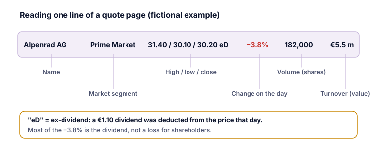

Ogni app di un broker, sito di una Borsa e sito di notizie finanziarie mostra per ogni azione una **pagina delle quotazioni**. L'impaginazione cambia, ma gli elementi di base sono gli stessi.

## I dati principali

La Wiener Börse spiega i dati di un tipico listino:

| Dato | Significato |
|---|---|
| **Nome, ticker, ISIN** | Di quale titolo si tratta. L'ISIN è univoco; i ticker cambiano da una Borsa all'altra (categoria A). |
| **Segmento di mercato** | Il segmento in cui l'azione è ammessa, in base a criteri come capitalizzazione e liquidità (categoria D). |
| **Massimo / Minimo / Chiusura** | I prezzi più alto, più basso e di chiusura della giornata. |
| **M/m/C precedenti** | Gli stessi dati per la giornata di Borsa precedente. |
| **+/− %** | Variazione del prezzo di chiusura rispetto al giorno precedente, in percentuale. |
| **Volume (azioni)** | Numero di azioni scambiate quel giorno. |
| **Controvalore (milioni di euro)** | Valore scambiato: volume × prezzo di chiusura. |
| **Rapporto P/E** | Quante volte l'utile per azione è contenuto nel prezzo (categoria I). |
| **Flottante** | Quota delle azioni in circolazione in Borsa (categoria C). |

Le pagine delle quotazioni online di solito aggiungono:

- **Denaro e lettera:** i prezzi migliori ai quali altri sono attualmente disposti a comprare e vendere, e lo **spread** tra di essi (categoria D).
- **Capitalizzazione di mercato:** prezzo dell'azione × numero di azioni (categoria I).
- **Massimo e minimo a 52 settimane:** l'escursione dell'ultimo anno.

## Differiti o in tempo reale?

I dati di prezzo gratuiti sono spesso **differiti**. Il sito della Wiener Börse stessa, per esempio, mostra i prezzi **con 15 minuti di ritardo**, con l'ATX in tempo reale. Una pagina delle quotazioni dovrebbe dire che cosa vale; cerca «differito», un orario o «tempo reale».

> [!WARNING] Non negoziare su un prezzo superato
> Un prezzo differito può essere vecchio in un mercato frenetico. Prima di inserire un ordine, controlla il denaro e la lettera in tempo reale nella schermata degli ordini del tuo broker, e valuta un ordine con limite di prezzo (categoria F).

## I codici accanto al prezzo

Giornali e listini aggiungono brevi codici (*Kurszusätze*). Due comuni in Austria (Wiener Börse):

- **eD**, *ex Dividende*: alla **data di stacco**, il prezzo è stato ridotto del dividendo (categoria G).
- **eB**, *ex Bezugsrecht*: dal prezzo è stato dedotto il valore del **diritto di opzione** (categoria V).

Entrambi spiegano cali di prezzo che **non sono perdite** per gli azionisti esistenti.

> [!EXAMPLE] Leggere una riga (immaginaria)
> Alpenrad AG · Prime Market · M/m/C 31,40 / 30,10 / 30,20 eD · −3,8% · Volume 182.000 · Controvalore 5,5 milioni di euro
>
> L'azione ha chiuso a 30,20 €, in calo del 3,8%, ma «eD» indica che quel giorno è avvenuto lo stacco del dividendo. Con un dividendo di 1,10 €, gran parte del calo è la detrazione del dividendo, non una perdita.

## Stessa azione, numeri diversi

Puoi vedere prezzi leggermente diversi per la stessa azione su siti diversi. Le ragioni comprendono:

- **Borse o sedi di negoziazione** diverse (categoria D);
- la **valuta**: la stessa società quotata in euro su una sede e in dollari su un'altra;
- dati **differiti** o in tempo reale;
- serie storiche **rettificate** o non rettificate dopo frazionamenti o dividendi (categorie J e V).

## Punti chiave

> [!TAKEAWAYS]
> - Massimo/minimo/chiusura, variazione, volume e controvalore descrivono la giornata di Borsa.
> - Denaro, lettera e spread mostrano a che prezzo potresti negoziare in questo momento.
> - I dati gratuiti sono spesso differiti; il sito della Wiener Börse mostra i prezzi con 15 minuti di ritardo.
> - «eD» ed «eB» indicano detrazioni di prezzo per stacco del dividendo e del diritto di opzione, non perdite.
> - I prezzi della stessa azione possono differire per sede, valuta, ritardo e rettifica.
