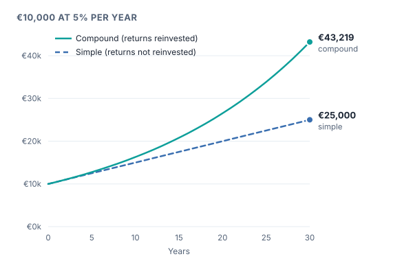

**Compound interest** is interest paid on both the original amount and on the interest already earned. The Vienna Stock Exchange describes the compound effect (Zinseszinseffekt) as arising from returns that are reinvested or retained straight away. The same principle applies to any investment whose returns are reinvested.

## Simple versus compound growth

> [!EXAMPLE]
> You invest **€10,000** and earn **5%** per year.
>
> - **Simple growth** (you take the €500 out every year and spend it): after 30 years you have the original €10,000 plus 30 × €500 = **€25,000** in total.
> - **Compound growth** (you leave everything invested): each year's 5% is earned on a growing amount. After 10 years you have about **€16,289**, after 20 years about **€26,533**, after 30 years about **€43,219**.

The formula behind it: **end value = start value × (1 + rate)^years**. For example, €10,000 × 1.05³⁰ ≈ €43,219.

## Time matters most

The curve gets steeper the longer it runs: in the example, the money grows by about €6,300 in the first 10 years, but by about €16,700 in the last 10. That is why starting early matters more than almost anything else for long-term investors.

## A handy shortcut: the rule of 72

To estimate how long it takes to **double** your money, divide 72 by the yearly return in percent.

> [!EXAMPLE]
> At 6% per year: 72 ÷ 6 = about **12 years** to double. (The exact answer is 11.9 years.)
> At 3% per year: 72 ÷ 3 = about **24 years**.

## Compounding works against you too

The same maths applies to **costs** and **debt**. A yearly fee of 1.5% compounds just like a return, slowly eating away a large part of long-term growth (see the lesson on costs). And debt with high interest, for example on a credit card, grows quickly if it is not paid back.

> [!WARNING]
> These examples use a steady, made-up 5% a year. Real investments do not grow smoothly: shares have bad years and even losing decades. Compounding is a powerful effect, not a guarantee of any particular result.

> [!MISTAKE] "I'll start investing later, when I have more money"
> Because compounding needs time, small amounts invested early can grow to more than larger amounts invested much later. Time is the one ingredient you cannot buy back.

## Key takeaways

> [!TAKEAWAYS]
> - Compound growth means earning returns on earlier returns.
> - End value = start value × (1 + rate)^years.
> - The rule of 72 estimates doubling time: 72 ÷ return in %.
> - Time is the most important ingredient; costs and debt compound too.
