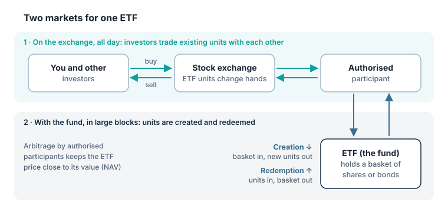

An **exchange-traded fund (ETF)** is a fund whose units are traded on a stock exchange throughout the day, just like shares. Most ETFs track an index, which makes them a simple way to buy a whole basket of shares in one trade.

## Two markets for one ETF

1. **Primary market:** large financial institutions called **authorised participants** (typically big broker-dealers) can create new ETF units or redeem existing ones directly with the fund, but only in large blocks (for example 50,000 units).
2. **Secondary market:** everyone else, including you, buys and sells ETF units on the exchange, from and to other investors and market makers.

## Creation and redemption

- **Creation:** an authorised participant delivers a basket of the underlying securities (or cash) to the ETF and receives a block of new ETF units, which it can then sell on the exchange.
- **Redemption:** the reverse: it returns a block of ETF units to the fund and receives the underlying securities (or cash).

## Why the price stays close to the value

The ETF calculates its **net asset value (NAV)** every business day. During the day, the market price can be a little above (**premium**) or below (**discount**) the value of its holdings. If the gap gets big enough, authorised participants can profit from it, and their trades push the price back:

> [!EXAMPLE]
> The ETF's holdings are worth **€50.00** per unit, but on the exchange the ETF trades at **€49.80** (a discount).
>
> An authorised participant buys ETF units cheaply at €49.80, redeems them with the fund for underlying shares worth €50.00, and sells those shares. The buying pushes the ETF's market price back up towards €50.
>
> If the ETF traded at a premium instead, the opposite happens through creation.

This mechanism usually keeps the price close to the value of the holdings, especially for ETFs on liquid markets. In stressed or illiquid markets, premiums and discounts can become larger.

## What this means for you

- You buy and sell ETFs through your broker like shares, with commissions and a **bid-ask spread**.
- For ETFs on very liquid indexes, spreads are often small; for niche ETFs they can be wider.
- Trading when the underlying market is closed (for example a US-shares ETF during the European morning) can mean wider spreads.

> [!MISTAKE] "An ETF is a share of one company"
> An ETF is a fund that holds many securities. When you buy one unit, you indirectly own a small slice of the whole basket, not shares of the ETF provider.

## Key takeaways

> [!TAKEAWAYS]
> - An ETF is a fund traded on an exchange throughout the day.
> - Authorised participants create and redeem units in large blocks with the fund.
> - Arbitrage by authorised participants usually keeps the ETF price close to its NAV.
> - Investors pay trading costs and spreads; niche ETFs can have wider spreads.
