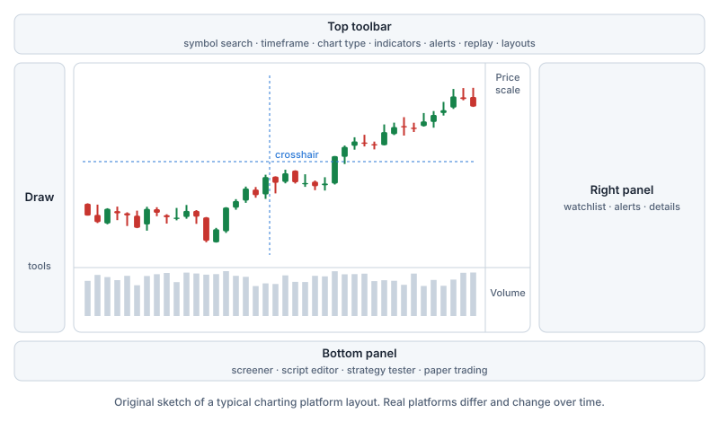

Charting platforms all look a little different, but they share the same building blocks. We use **TradingView** as the example because it is widely known. The same concepts apply to the charts in your broker's app or any other platform.

> [!NOTE] Neutral description, no recommendation
> Stockora Academy has no affiliation with TradingView or any other platform, uses no affiliate links and does not recommend a platform or a plan. Features and prices change: check the [official website](https://www.tradingview.com/) for the current state. The illustration below is our own sketch, not a screenshot.

## What it is

TradingView is a web-based charting and market analysis platform, with mobile and desktop apps. It covers stocks, indexes, currencies, crypto and futures, and has a social side where users publish their chart analyses ("ideas").

## The interface

- **Top toolbar:** symbol search, timeframe selector, chart type, indicators, alerts, replay, layouts.
- **Left toolbar:** drawing tools.
- **Chart area:** candles, a volume pane, a crosshair that follows your mouse, and the price and time scales.
- **Right panel:** watchlists, alerts, news and details about the symbol.
- **Bottom panel:** screener, script editor, strategy tester (strategy report), paper trading and broker connections.

## Symbols and data

- **Exchange prefix:** symbols can carry an exchange prefix, such as `NASDAQ:AAPL`. The same company can trade on several exchanges and in different currencies, so check which listing you are looking at.
- **Delayed vs real-time:** most stock and futures exchanges charge fees for real-time data, so data for many exchanges is **delayed** unless you buy a data package. TradingView says its paid plans do not cover these exchange fees. If you already pay for real-time data through a broker, it can in some cases be used on the platform.
- **Data source:** by default, TradingView shows US stock prices from Cboe, which can differ slightly from the primary exchanges.

## Chart settings worth checking

Candle colours, linear or log scale, adjustment for splits and dividends, the **time zone** of the chart, extended-hours sessions and session breaks. A chart in the wrong time zone or with unadjusted prices can look very different.

## Indicators and scripts

- A built-in library of indicators (moving averages, RSI, MACD, Bollinger Bands and many more), each with adjustable settings such as the length and the source price.
- **Pine Script** is the platform's own programming language for custom indicators and strategies, written in an editor in the bottom panel. Many **community scripts** are published by users. Their quality varies, and a script is not advice.
- The **strategy tester (strategy report)** shows how a scripted strategy would have performed on past data, with all the backtesting traps from lesson 9.

## Drawing tools

Trendlines, horizontal lines and rays, parallel channels, rectangles for zones, Fibonacci retracements, a measuring tool, **long/short position tools** that show the planned risk and reward of a trade, text notes and anchored VWAP.

## Alerts

Alerts send you a notification when a price or an indicator condition is met, for example a price crossing a level. Useful for not having to watch the screen, but many alerts can also lead to **over-trading and FOMO**.

## Replay mode

**Bar replay** plays past candles one by one from a starting point you pick, so you can practise reading charts without knowing what comes next.

## Screener, watchlists and layouts

Watchlists, multi-chart layouts with a synced crosshair, saved templates, and a **screener** that filters markets by criteria such as market value, P/E ratio or volume. A screener result is a list that matches your filters, not a recommendation.

## Paper trading and broker connections

- **Paper trading:** a simulated account with virtual money, available to all users according to TradingView.
- **Broker connections:** some brokers can be connected so that orders are placed from the chart. That is convenient, but it also makes trading very quick and easy, including impulsive trades. Check who your broker is, where it is regulated and what it costs (Category F).

## Community ideas

Users publish their chart analyses as **ideas**, which are shown to their followers and to people following the symbol; popular ones rise to the front page. Read them with care: popularity is not accuracy, and social feeds are also used for **hype, "signal" selling and scams** (see the [Scam Shield](/scams)).

## Plans

There is a free plan and several paid plans with more features. Which one suits you, if any, is your decision; check the official site for the current differences. Real-time data from many exchanges costs extra on top of a plan.

## Risks and limits

- delayed data mistaken for live prices;
- the wrong time zone or unadjusted prices;
- **repainting** indicators that rewrite their past signals;
- overfitted backtests in the strategy tester;
- too many alerts and social-feed FOMO.

> [!MISTAKE] "This idea has thousands of likes, so it must be right"
> Ideas are opinions. Popular ideas are not checked for accuracy, and published charts are easy to cherry-pick after the fact.

**Try the guided walkthrough:** the [Chart Lab](/charts/lab) has the same building blocks (chart types, timeframes, indicators, drawing tools, replay), and a "read this chart step by step" tour that follows the checklist from lesson 9.

## Key takeaways

> [!TAKEAWAYS]
> - Charting platforms share the same parts: symbol search, timeframes, chart types, indicators, drawing tools, alerts, replay, screener and panels.
> - Check the exchange prefix, currency, time zone, adjustment settings and whether data is delayed.
> - Community scripts and ideas are not advice; quality varies and hype is common.
> - Replay and paper trading are for practice; backtests and alerts have their own risks.
> - We describe TradingView as an example only; features and prices change, so check the official site.
