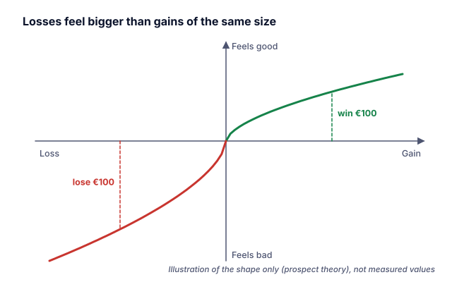

## Losses hurt more

The FMA describes **loss aversion**: the subjective value of a gain is often rated lower than an objectively equal loss. Investors experience losses **much more intensely** than comparable gains, so they focus more on avoiding losses than on taking opportunities. This idea is central to Kahneman and Tversky's **prospect theory** (lesson 1).

> [!EXAMPLE] A coin toss
> Would you accept a bet where heads wins €110 and tails loses €100? On average it pays €5 per toss. Loss aversion predicts that many people will still hesitate, because the possible loss feels bigger than the larger possible gain.

## The disposition effect: selling winners, keeping losers

Loss aversion shows up in what investors sell. The FMA notes that shares that have done well are regularly sold first, but not those that have produced losses.

Terrance Odean tested this **disposition effect**, the tendency to hold losing investments too long and sell winning investments too soon, using trading records for **10,000 accounts** at a large US discount broker. He found that investors showed a **strong preference for realising winners rather than losers**. This behaviour was not explained by a wish to rebalance or to avoid trading costs, and was **not justified by later performance**. For taxable accounts it also led to **lower after-tax returns**.

> [!EXAMPLE] Two shares, one decision
> You own share A, bought at €50, now €60 (+20%), and share B, bought at €50, now €40 (−20%). You need €2,000.
> - The tempting choice: sell A to "lock in a profit" and keep B "until it comes back".
> - The better question: which of the two would you **buy today** at the current price? The purchase price is history; it does not affect what either share will do next.

## The endowment effect

The Nobel committee describes Richard Thaler's finding that loss aversion can explain why people value the same item **more highly when they own it** than when they do not: the **endowment effect**. Investors can become attached to shares they own and rate them higher than identical shares they don't own.

## How to counter it

The FMA suggests:

- **Ignore the purchase price** as a decision criterion. Ask whether you would buy at today's price.
- Look at the **performance of the whole portfolio**, not each position separately.
- Accept that in a well-diversified portfolio, **some positions will always do worse** than others.
- Consider a **stop-loss order**, set when you buy, which automatically sends a sell order if the price falls to a chosen level (Category F). Keep in mind that in fast markets the execution price can be lower than the stop level.

> [!AUSTRIA] Taxes can matter, but should not dominate
> In Austria, losses from capital assets can only be offset against certain other capital income, under the rules of § 27 (8) EStG; Category Q explains them. Let the investment case decide, and use tax rules only as a secondary consideration.

## Key takeaways

> [!TAKEAWAYS]
> - Losses feel more intense than equal gains (loss aversion, FMA; prospect theory).
> - Investors tend to sell winners and keep losers: the disposition effect (Odean, 10,000 accounts).
> - This behaviour was not justified by later returns and lowered after-tax returns.
> - People value what they own more highly: the endowment effect (Thaler).
> - Ask: would I buy this share today at this price?
