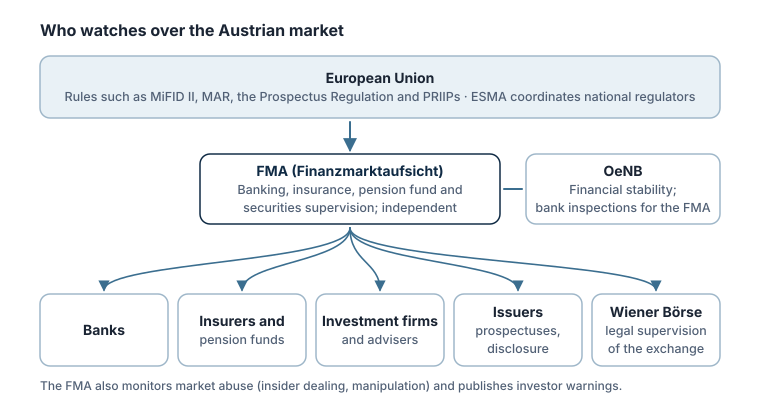

Financial markets run on trust. Investors only hand over their money if they can rely on prices being fair, information being true and their assets being safe. **Regulators** set and enforce the rules that make this possible.

## The FMA: Austria's financial market authority

The **Finanzmarktaufsichtsbehörde (FMA)** describes itself as an institution under public law, established by constitutional provision to carry out **banking, insurance, pension fund and securities supervision**. It is also Austria's **national resolution authority** for failing banks. It covers the whole country and is **not bound by instructions** in exercising its duties.

The FMA groups its work into two approaches:

- **Solvency supervision:** making sure banks, insurers and financial service providers can pay their obligations at all times.
- **Market and conduct supervision:** ensuring **fair and transparent** markets and that minimum standards of corporate governance, **client advice and information** are met.

It also fights unauthorised banking and financial services, works on preventing money laundering and terrorist financing, and, from 1 January 2026, monitors and enforces international financial sanctions.

> [!AUSTRIA] What the FMA does for investors
> On the securities side, the FMA approves prospectuses, supervises issuers' disclosure duties, monitors market abuse such as insider dealing and manipulation, and supervises investment firms and their conduct towards clients. It also handles complaints about supervised companies (lesson 8) and publishes investor warnings (Category T).

## The European layer

Most capital market rules in Austria come from the **European Union**: MiFID II for investment services, the Market Abuse Regulation (MAR), the Prospectus Regulation, PRIIPs for key information documents. National regulators apply them; the **European Securities and Markets Authority (ESMA)** coordinates and can, in some cases, intervene directly, as it did with CFDs in 2018 (Category N).

For failing banks, the **Single Resolution Board (SRB)** and national resolution authorities such as the FMA apply common EU resolution tools (lesson 7).

## The central bank

The **Oesterreichische Nationalbank (OeNB)** is part of the Eurosystem and contributes to financial stability (Category L). The FMA notes that it commissions the OeNB to carry out on-site inspections of banks.

## The stock exchange

The **Vienna Stock Exchange** (Wiener Börse AG) operates the market and sets its rules, for example for its market segments and trading (Category D). The FMA exercises legal supervision over exchanges.

## Other countries

Each country has its own regulators. In the US, the **Securities and Exchange Commission (SEC)** oversees securities markets; its investor website Investor.gov is used as a source throughout this academy. If you invest through a foreign firm, it is supervised in its home country, and protections can differ (Category F).

> [!TIP] Check before you invest
> Before giving money to any firm, check that it is authorised for the service it offers, for example in the FMA's company database. Category T explains how.

## Key takeaways

> [!TAKEAWAYS]
> - The FMA supervises banks, insurers, pension funds, investment firms and the securities markets in Austria, independently of instructions.
> - Its work combines solvency supervision and market and conduct supervision.
> - Most rules come from EU law; ESMA coordinates national regulators across the EU.
> - The OeNB contributes to financial stability and carries out on-site bank inspections for the FMA.
> - Always check that a firm is authorised before you invest.
