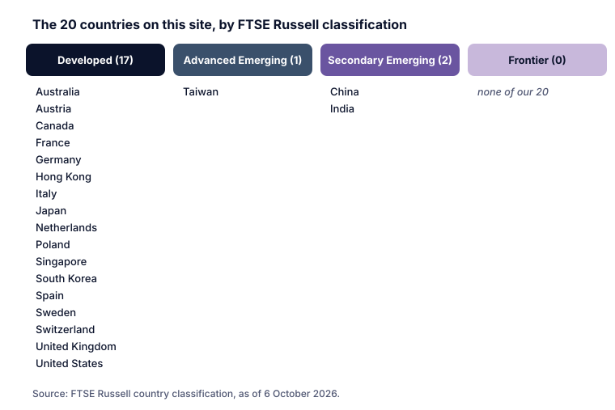

Global index providers group countries' stock markets into categories. These labels decide which countries end up in funds such as "World" or "Emerging Markets" ETFs (Category H), so they matter even if you never pick a country yourself.

## MSCI's categories

MSCI evaluates equity markets every year and classifies them as **developed, emerging, frontier or standalone**. Its framework uses three criteria:

1. **Economic development:** only used to determine developed market status.
2. **Size and liquidity:** whether enough securities meet minimum investability requirements.
3. **Market accessibility:** based on five criteria reflecting international institutional investors' real experience of accessing and trading in a market.

MSCI announces its annual **market accessibility review** and **market classification review** every **June**. Markets can also be placed on a list for **potential reclassification** in the next cycle. **Standalone** markets are either newly eligible markets or markets reclassified after severe deterioration in accessibility or in size and liquidity; they are not included in MSCI's Emerging or Frontier Markets indexes.

## FTSE Russell's categories

FTSE Russell uses four groups: **Developed, Advanced Emerging, Secondary Emerging and Frontier**. It reviews all markets in its global benchmarks annually and publishes the **Annual Country Classification Announcement each September**, along with a **Watch List** of markets being considered for a change. Its **Quality of Markets** matrix checks criteria such as:

- whether formal regulatory authorities actively monitor the market;
- fair and non-prejudicial treatment of **minority shareholders**;
- foreign ownership restrictions;
- restrictions on investing capital or **repatriating** it;
- the World Bank's income classification and the market's **creditworthiness**.

> [!AUSTRIA] Austria's classification
> In FTSE Russell's Quality of Markets criteria for Europe as at September 2026, **Austria** is listed among the **Developed** markets.

> [!EXAMPLE] A market moving up: Greece
> FTSE Russell reclassified **Greece** from Advanced Emerging to **Developed** status, effective from the **September 2026** semi-annual review of its global equity indexes. Index funds tracking FTSE's developed and emerging indexes must adjust their holdings at such changes.

## Why classifications matter

- **Fund contents:** a "Developed World" ETF and an "Emerging Markets" ETF hold different countries according to these lists (Category H).
- **Money flows:** when a market is promoted or demoted, index funds must buy or sell, which can move prices (Category H, index rebalancing).
- **Risk profile:** emerging and frontier markets often have higher volatility, currency risk and different investor protections (lesson 3).

> [!NOTE] Providers can disagree
> MSCI and FTSE Russell use different criteria and timetables, so a country can be classified differently by each. Check which index your fund tracks.

## Key takeaways

> [!TAKEAWAYS]
> - MSCI classifies markets as developed, emerging, frontier or standalone, reviewing them every June.
> - FTSE Russell uses developed, advanced emerging, secondary emerging and frontier, announcing changes each September.
> - Criteria include economic development, size and liquidity, accessibility, and treatment of foreign and minority investors.
> - FTSE Russell lists Austria as developed; Greece was promoted to developed effective September 2026.
> - Classifications decide which countries are in your "World" or "Emerging" fund.
