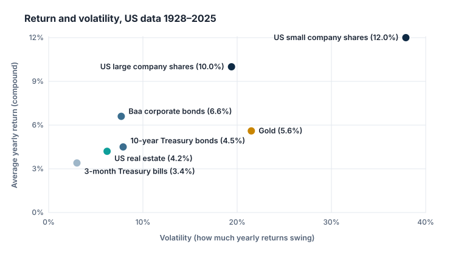

Shares are only one way to invest. This category looks at the others: bonds, cash, property, gold and commodities, currencies and crypto-assets. First, an overview of how some of them have behaved.

## Nearly a century of data

Aswath Damodaran at NYU Stern publishes yearly US returns for several asset classes. Using his data for **1928 to 2025** (98 years; own calculation; in US dollars, before inflation, costs and taxes):

| Asset class | Average yearly return (compound) | Volatility | Years with a loss | Worst year |
|---|---:|---:|---:|---:|
| US large company shares (S&P 500) | 10.0% | 19.4% | 26 | −43.8% (1931) |
| US small company shares | 12.0% | 37.9% | 34 | −53.9% (1937) |
| Baa-rated corporate bonds | 6.6% | 7.7% | 16 | −15.7% (1931) |
| 10-year US Treasury bonds | 4.5% | 7.9% | 20 | −17.8% (2022) |
| US real estate | 4.2% | 6.2% | 15 | −12.0% (2008) |
| Gold | 5.6% | 21.5% | 34 | −32.6% (1981) |
| 3-month US Treasury bills (cash-like) | 3.4% | 3.0% | 0 | +0.03% (2014) |

*"Worst year" for bills is the lowest positive year. See the dataset's notes for how each series is measured.*

## What stands out

- **Higher return came with higher risk.** Small company shares earned the most and swung the most. Treasury bills never lost money in a year, but earned the least.
- **"Safe" is relative.** Government bonds lost 17.8% in 2022 (Category L), and cash-like bills, while never negative, earned the least; after inflation, cash can lose purchasing power (Category G).
- **Gold was as volatile as shares** but earned less over the whole period, and produces no income. Its series barely moves for decades in the middle of the century (nine years between 1941 and 1959 show exactly 0.00%); for 1972–2025 alone, gold returned 8.9% a year with 27.3% volatility, more volatile than the S&P 500 (17.0%) in the same period.
- **Different assets fell in different years**, which is the basis of diversification (Category M).

The SEC's beginners' guide summarises the main trade-off: shares have historically had the greatest risk and highest returns, bonds are generally less volatile with more modest returns, and cash is the safest with the lowest returns, where the main concern is inflation.

> [!WARNING] One country, one currency, one century
> These are US figures in dollars. For a euro investor, currency moves would change the results, and other countries' histories differ. The past does not predict the future.

## Key takeaways

> [!TAKEAWAYS]
> - Over 1928–2025 in US data, shares returned the most and swung the most; Treasury bills the least.
> - Government bonds and property also had losing years; bonds lost 17.8% in 2022.
> - Gold was about as volatile as shares but earned less and pays no income.
> - Different asset classes often fall in different years, which makes mixing them useful.
> - Long-run US data is a guide, not a forecast.
