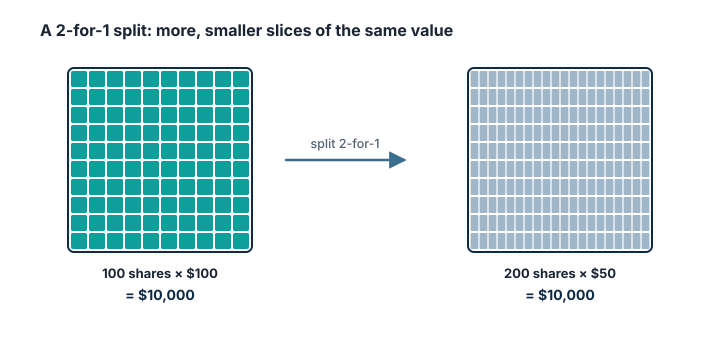

## The share split

The Wiener Börse defines a **share split** as dividing the share capital into smaller units, while the share capital and the **total value of the shares stay the same**. Investor.gov adds that, unlike issuing new shares, a split **does not dilute** existing shareholders.

> [!EXAMPLE] A 2-for-1 split (Investor.gov's example)
> You own 100 shares at $100 each: $10,000.
> After a two-for-one split you own **200 shares at $50**: still $10,000.
> If the company pays a dividend, the dividend **per share** also falls proportionately.

Why split? Investor.gov notes that companies often split to make their shares more **affordable** to investors. A lower price per share can make it easier to buy small amounts, although fractional shares (Category C) do much the same.

> [!AUSTRIA] There is a lower limit
> Under § 8 AktG, par value shares must be at least **€1**, and for no-par shares the portion of share capital per share must also be at least **€1**. A company cannot split its shares below that.

## The reverse split

A **reverse split** does the opposite: it **reduces the number of shares** and **raises the price per share** without changing the total economic value (Investor.gov).

> [!EXAMPLE] A 1-for-10 reverse split
> 1,000 shares at €0.80 (€800) become **100 shares at €8** (€800).

Investor.gov explains that a company might do a reverse split with a ratio like **1-for-5** to meet an exchange's **minimum price** requirements for continued listing. That alone is a sign that the share price has fallen a long way. The SEC also warns about "mammoth" reverse splits, such as 1-for-20,000, which can be part of fraud schemes using dormant shell companies (Category T).

## Bonus shares

When a company converts **reserves** into share capital (*Kapitalberichtigung*), shareholders receive new shares **without paying** anything. The Wiener Börse calls the popular terms "bonus shares" or "free shares" **misleading**: shareholders already owned a share of those reserves, and the share price falls in proportion, so mathematically the total value does not change.

## Charts and adjusted prices

After a split, price charts and data services usually show **adjusted** historical prices, so a 2-for-1 split doesn't look like a 50% crash. When comparing old prices, for example in an old newspaper or annual report, check whether they are adjusted (Category J).

> [!MISTAKE] "It's cheaper now, so it's a bargain"
> After a split, the share costs less, but you get a smaller slice of the same company. Valuation ratios such as the P/E ratio stay unchanged (Category I).

## Key takeaways

> [!TAKEAWAYS]
> - A split divides the same value into more shares; it does not dilute you.
> - Dividends per share fall in proportion after a split.
> - A reverse split merges shares, often after a large price fall; very large ratios can be a fraud warning sign.
> - Bonus shares from reserves give nothing extra: the price falls in proportion.
> - In Austria, each share must represent at least €1 of share capital.
